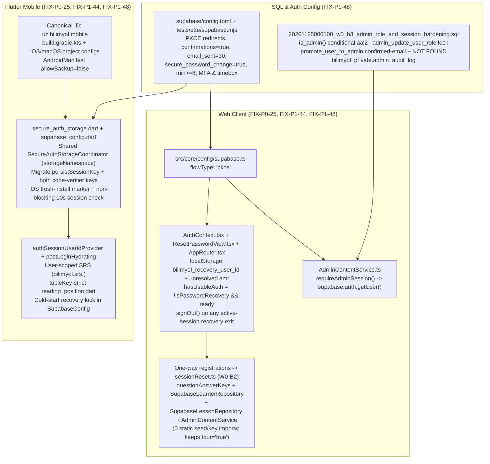

# Wave 0 · Batch `W0-B3` Pre-Implementation Scope Review & Implementation Plan

> **For agentic workers (UPON EXPLICIT USER APPROVAL ONLY):** REQUIRED SUB-SKILL: Use `superpowers:subagent-driven-development` (recommended) or `superpowers:executing-plans` to implement this plan task-by-task. Steps use checkbox (`- [ ]`) syntax for tracking. **CURRENT STATUS: PRE-IMPLEMENTATION SCOPE REVIEW ONLY — ZERO PRODUCT OR CONFIG FILES MODIFIED.**

**Goal:** Eliminate cross-account session/cache contamination across Web & Flutter, lock `/reset-password` recovery sessions across reloads, tabs, and app restarts so they can never escalate into learner or admin workspaces, upgrade Mobile auth token & PKCE persistence to encrypted storage under canonical `uz.bilimyol.mobile` (with Web `pkce` enabled), and enforce sole-admin/last-admin demotion guards, step-up `aal2` admin MFA checks, audit logging, and server-verified session revocation checks (`FIX-P0-25`, `FIX-P1-44`, `FIX-P1-48`).

**Architecture:** Execute `W0-B3` as four cohesive, TDD-gated tasks plus one full-stack regression & documentation gate on top of `fix/wave-0-critical-containment` (`HEAD: 935e9aa76d508dc9ee62aa22f4f714342c6975b0`):
1. **PostgreSQL Admin, MFA `aal2` & Auth Config Hardening (`FIX-P1-48`):** Forward transactional migration (`SET search_path = ''`) adding `bilimyol_private.admin_audit_log`, enforcing `aal2` step-up in `public.is_admin()` when the admin has a verified MFA factor, locking `public.admin_update_user_role` against self-demotion, last-admin demotion, and `READ COMMITTED` concurrent admin revocation (`pg_advisory_xact_lock` + `FOR UPDATE` + post-lock caller re-check), requiring `email_confirmed_at IS NOT NULL` + `profiles` existence in `public.promote_user_to_admin` (preserving `W0-B1`'s `REVOKE` posture), hardening `supabase/config.toml`, and updating `tests/e2e/supabase.mjs` for `enable_confirmations = true`.
2. **Web Session Isolation, `/reset-password` Lock, `pkce` & Admin `getUser()` (`FIX-P0-25`, `FIX-P1-44`, `FIX-P1-48`):** Enable `flowType: 'pkce'`, persist `bilimyol_recovery_user_id` in `localStorage` (cross-tab aligned with `sb-<ref>-auth-token`) + inspect unresolved JWT `amr` recovery claims without `INITIAL_SESSION` wipe or post-`updatePassword()` `amr` re-lock, gate `AppRouter` `hasUsableAuth` on `!isPasswordRecovery`, enforce `signOut()` whenever exiting `/reset-password` with an active session, wire zero-static-seed logout cache purges via `sessionReset.ts` (preserving `bilimyol.product_tour_completed === 'true'`), and verify `supabase.auth.getUser()` once per live `AdminContentService` call.
3. **Mobile Canonical `uz.bilimyol.mobile` ID & `FlutterSecureStorage` Upgrade (`FIX-P1-44`, `FIX-P1-48`):** Unify Android `applicationId` and iOS/macOS `PRODUCT_BUNDLE_IDENTIFIER` on `uz.bilimyol.mobile`, add offline-cached `flutter_secure_storage: ^10.0.0`, coordinate one-time migration + cleartext deletion of `persistSessionKey`, `'${persistSessionKey}-code-verifier'`, and `'supabase.auth.token-code-verifier'` via a shared `SecureAuthStorageCoordinator` (with iOS fresh-install Keychain purge, Android `PlatformException` recovery, and `MissingPluginException` in-memory test fallback), validate `https://` + callback-parameterized `detectSessionInUriPredicate`, set `android:allowBackup="false"`, and run non-blocking bounded `verifyActiveSessionOrSignOut()`.
4. **Mobile `authSessionUserIdProvider` Graph, Scoped SRS/Reading Keys & Hydration Redirect Guards (`FIX-P0-25`):** Watch `authSessionUserIdProvider` across Flutter repositories and all 5 `StateNotifier`s, scope authenticated local SRS by `user.id` (`bilimyol.srs.<uid>`) instead of `bilimyol.demo_learner_snapshot`, enforce `tupleKey`-only reads/writes when `accountId` is present in `LessonReadingPositionStore`, attach cold-start recovery tracking inside `SupabaseConfig.initialize()`, block logged-out provider queries in `router.dart`, and hold `GoRouter` redirects via `postLoginHydrating` until profile + course hydration settles.

**Architecture Diagram:**

**Tech Stack:** React `19` + TypeScript + Vite `8` + Zustand (`src/`), Flutter `3.x` + Riverpod `2.6.1` + GoRouter `17.5.0` + `supabase_flutter` `2.17.2` + `gotrue` `2.27.2` + `flutter_secure_storage` `10.3.1` (`mobile/`), PostgreSQL `17.11` + PL/pgSQL (`supabase/migrations/`), Vitest (`node`) + Playwright (`supabase.mjs`) + `flutter_test` + `psql`.

**Spec:**
- [ENGINEERING_TRANSFORMATION_MASTER_PLAN.md](file:///C:/Users/user/.gemini/antigravity/worktrees/Bilimyol/global_ai_hackathon_jury/docs/hackathon-audit/ENGINEERING_TRANSFORMATION_MASTER_PLAN.md#L34-L122)
- [FINAL_FINDINGS_MATRIX.md](file:///C:/Users/user/.gemini/antigravity/worktrees/Bilimyol/global_ai_hackathon_jury/docs/hackathon-audit/FINAL_FINDINGS_MATRIX.md#L152-L167)
- [FINAL_RISK_REGISTER.md](file:///C:/Users/user/.gemini/antigravity/worktrees/Bilimyol/global_ai_hackathon_jury/docs/hackathon-audit/FINAL_RISK_REGISTER.md#L53-L112)
- [PRIORITIZED_FIXES.md](file:///C:/Users/user/.gemini/antigravity/worktrees/Bilimyol/global_ai_hackathon_jury/docs/hackathon-audit/PRIORITIZED_FIXES.md#L35-L94)
- [SECURITY_JURY.md](file:///C:/Users/user/.gemini/antigravity/worktrees/Bilimyol/global_ai_hackathon_jury/docs/hackathon-audit/SECURITY_JURY.md#L110-L197)
- [AUTH_SESSION_SECURITY.md](file:///C:/Users/user/.gemini/antigravity/worktrees/Bilimyol/global_ai_hackathon_jury/docs/hackathon-audit/AUTH_SESSION_SECURITY.md#L1-L80)
- [ENGINEERING_FINDINGS.md](file:///C:/Users/user/.gemini/antigravity/worktrees/Bilimyol/global_ai_hackathon_jury/docs/hackathon-audit/ENGINEERING_FINDINGS.md#L52-L70)

## Global Constraints

- **Zero Big-Bang Rewrites:** Implement strictly `FIX-P0-25`, `FIX-P1-44`, and `FIX-P1-48` (+ mandatory canonical `uz.bilimyol.mobile` sandbox continuity and active-CI `supabase.mjs` confirmation alignment); do not pull `W0-B4` (`jsdom`, release keystore/R8, full `demoSessionActive` wiring), `W1-B1` (`FIX-P1-55`), or `W4-B2` (`FIX-P1-39` `/callback` signup deep-link) into `W0-B3`.
- **Forward-Only Transactional SQL Migrations:** Never modify historical `supabase/migrations/2026*.sql` files (including `W0-B1`'s `20261124000100_w0_b1_rpc_authz_reinforcement_and_xp_hardening.sql`); author one new `BEGIN; ... COMMIT;` migration (`SET search_path = ''`) idempotent on `2x` execution across both Cloud-Default and Legacy-Grant postures.
- **Preserve `W0-B2` Zero-Answer-Key Bundle Split (`FIX-P0-23`):** Never statically import any module in `BANNED_LIVE_MODULES` ([W0B2BundleAnswerKeyIsolation.test.ts:29-50](file:///C:/Users/user/.gemini/antigravity/worktrees/Bilimyol/fix_wave_0_critical_containment/src/__tests__/W0B2BundleAnswerKeyIsolation.test.ts#L29-L50) — including `src/core/runtime/questionAnswerKeys.ts`, `InMemoryLessonRepository.ts`, `InMemoryLearnerRepository.ts`, `lessons.ts`, and `questions.ts`) from `AuthContext.tsx` or `sessionReset.ts`; those modules must register one-way into `sessionReset.ts` only when dynamically loaded.
- **Canonical Bundle/Scheme Identifier (`uz.bilimyol.mobile`):** Unify Android `applicationId` and iOS/macOS `PRODUCT_BUNDLE_IDENTIFIER` with auth deep-link scheme `uz.bilimyol.mobile` from `W0-B3` onward (retaining Android Kotlin `namespace = "uz.bilimyol.bilimyol_mobile"` so `MainActivity.kt` package resolution is untouched) so Keychain/Keystore sandboxes are never orphaned in `W4-B2` or `W6-B2`.
- **Hosted Cloud & Domain Verification Honesty Boundary:** Local `supabase/config.toml` is hardened in-repo, while live Supabase Cloud Dashboard toggles remain explicitly documented as `UNVERIFIED`; OS-level HTTPS App Links / Universal Links domain verification (`/.well-known/assetlinks.json` & `apple-app-site-association`) remains explicitly `BLOCKED` on production release signing cert SHA-256 (`W0-B4`) and Apple `DEVELOPMENT_TEAM` (`W6-B2`).

## Review Focus (Top 5 Subtle Failure Modes Caught & Pinned to Tasks)

1. **GoTrue `getUser()` Does Not Auto-Refresh Expired Access Tokens (`gotrue-2.27.2:874`):** Calling `client.auth.getUser()` directly on cold boot when `currentSession.isExpired == true` (`>1h`) returns `401` and would falsely wipe valid returning users' `refresh_token`s; awaiting it before `runApp()` also hangs splash screens offline. Task 3 runs `unawaited(verifyActiveSessionOrSignOut())` with a `10s` timeout, using `refreshSession()` when `session.isExpired` and `getUser()` only when `!session.isExpired`.
2. **Web `/reset-password` `INITIAL_SESSION` Wipe, Cross-Tab `localStorage` Leak & Post-Update `amr` Re-Lock:** `onAuthStateChange('INITIAL_SESSION')` sees `changedAccount === true` (`null !== userId`) and wipes `recoveryUserId` unless recovery checks precede `else if (changedAccount)`; `sessionStorage` misses cross-tab `SIGNED_IN` broadcasts from `localStorage`; and GoTrue's append-only `amr` keeps `'recovery'` after `updateUser({ password })` unless superseded by a newer `'password'` entry or cleared marker. Task 2 pins all three transitions (and never treats a bare `/reset-password` path without callback/session markers as recovery).
3. **PostgreSQL `READ COMMITTED` Revoked-Admin Race & `0A000` `COUNT(*) FOR UPDATE`:** Under `READ COMMITTED`, Caller B can pass a pre-lock `is_admin()` check while Admin A concurrently demotes Caller B, then execute after acquiring `pg_advisory_xact_lock`. Task 1 locks rows with `PERFORM 1 FROM public.profiles ... FOR UPDATE` and **re-verifies `public.is_admin()` after locking**, plus checks `IF NOT FOUND` in `promote_user_to_admin`.
4. **`flutter_secure_storage-10.3.1` `@Deprecated` `sharedPreferencesName`, Dual-Adapter Init Race & `MissingPluginException`:** `sharedPreferencesName` fails `dart analyze --fatal-infos` (use `storageNamespace`), `GotrueAsyncStorage` lacks `initialize()` (share one `SecureAuthStorageCoordinator.ensureInitialized()`), and unmocked Dart VM tests (`local_supabase_test.dart`) throw `MissingPluginException` unless caught with an instance-scoped in-memory map fallback. Task 3 pins all three.
5. **Active CI Breakage on `enable_confirmations = true` (`tests/e2e/supabase.mjs` + `email_sent = 2`) & `AdminContentQueries.test.ts`:** `.github/workflows/ci.yml:70` runs `npm run test:e2e:supabase` on every PR (`3` emails sent across `first` signup, recovery, and `second` signup vs `email_sent = 2` in `config.toml:199`), and `AdminContentQueries.test.ts` runs `AdminContentService` without an active GoTrue session. Task 1 and Task 2 update both test files atomically.

---

## 1. Aniq `FIX-*` ID'lari va Severity

| Fix ID | Audit Alias | Severity | Confidence & Evidence | Platformalar | Release Gate Status |
|---|---|---|---|---|---|
| **`FIX-P0-25`** | `ENG-03` | **`P0` (`Critical`)** | `RUNTIME_PROVEN` (`EV-055`, `EV-056`, `EV-062` — 2-account harness + code trace) | Web (`src/`), Flutter Mobile (`mobile/`) | **Hard P0 Blocker** |
| **`FIX-P1-44`** | `SEC9-03` | **`P1` (`High`)** | `SOURCE_CONFIRMED` (`EV-063` — SDK source + manifest audit) | Flutter Mobile (`mobile/`), Web (`src/`) | **Pre-Prod P1 Gate** |
| **`FIX-P1-48`** | `SEC9-07` | **`P1` (`High`)** | `RUNTIME_PROVEN` (`EV-061`, `EV-063` — PG17 probe; Hosted Cloud = `UNVERIFIED`) | Supabase SQL, `supabase/config.toml`, Web Admin, Flutter Mobile | **Pre-Prod P1 Gate** |

> [!NOTE]
> **Qat’iy Scope Chegarasi (Deferred Sibling IDs):** Quyidagi qo‘shni ID'lar `ENGINEERING_TRANSFORMATION_MASTER_PLAN.md` bo‘yicha o‘z batchlarida qoladi va `W0-B3` ga qo‘shilmaydi: `FIX-P0-26` va `FIX-P2-11` (`W0-B4`), `FIX-P1-55` (`W1-B1`), `FIX-P1-12` va `FIX-P1-39` (`W4-B2`), `FIX-P1-42` (`W4-B1`), `FIX-P1-54` (`W6-B2`), `FIX-P3-06` (`W6-B3`).

---

## 2. Har Bir Muammoning Root Cause Tahlili (`HEAD: 935e9aa7` Bo‘yicha Tekshirilgan)

### 2.1 `FIX-P0-25` (`P0`) — Ko‘p Hisobli State Kontaminatsiyasi, Logged-Out So‘rovlar, Login Redirect Poygasi va `/reset-password` Escalation

1. **Flutter: Autentifikatsiyalangan SRS umumiy Demo kalitiga yoziladi ([supabase_learner_repository.dart:406-416, 947-949](file:///C:/Users/user/.gemini/antigravity/worktrees/Bilimyol/fix_wave_0_critical_containment/mobile/lib/data/repositories/supabase_learner_repository.dart#L406-L416)):**
   - `recordFlashcardReview` real cloud rejimida ham `user.id` bo‘yicha ajratilmagan `_fallbackRepo` (`SharedPreferences['bilimyol.demo_learner_snapshot']`) ga yozadi, `clearLocalState()` (`line 947`) esa `mobile/lib/` bo‘yicha **`0` marta** chaqirilgan. **User A** chiqib **User B** kirib 1 ta flashcard ko‘rsa, User A ning butun SRS lug‘ati User B profiliga qo‘shilib ketadi.
2. **Flutter: `LessonReadingPositionStore.readStepIndex` ([reading_position.dart:87-99](file:///C:/Users/user/.gemini/antigravity/worktrees/Bilimyol/fix_wave_0_critical_containment/mobile/lib/features/lesson/reading_position.dart#L87-L99)) unscoped `primaryKey` ni birinchi o‘qiydi:**
   - `saveStepIndex` (`lines 113-119`) unscoped `'bilimyol-reading:<lessonId>'` (`primaryKey`) va `tupleKey(accountId, courseId, lessonId)` ni baravar yozadi; `readStepIndex` (`line 87`) esa avval `primaryKey` ni o‘qib, User B ni User A to‘xtagan qadamga (`step = 3`) sakratadi. Shuningdek [providers.dart:1226](file:///C:/Users/user/.gemini/antigravity/worktrees/Bilimyol/fix_wave_0_critical_containment/mobile/lib/app/providers.dart#L1226) `accountId: profile?.id` uzatgani uchun profil yuklanishidan oldin `null` ketishi mumkin.
3. **Flutter: Riverpod provayderlari auth sessiya identifikatoriga bog‘lanmagan, logged-out so‘rovlar va post-login redirect poygasi mavjud ([providers.dart:173-188, 442, 594, 1033, 1065, 1908](file:///C:/Users/user/.gemini/antigravity/worktrees/Bilimyol/fix_wave_0_critical_containment/mobile/lib/app/providers.dart#L173-L188); [router.dart:29-46, 62-74, 126-145](file:///C:/Users/user/.gemini/antigravity/worktrees/Bilimyol/fix_wave_0_critical_containment/mobile/lib/app/router.dart#L29-L74); [profile_screen.dart:104-123](file:///C:/Users/user/.gemini/antigravity/worktrees/Bilimyol/fix_wave_0_critical_containment/mobile/lib/features/profile/profile_screen.dart#L104-L123); [login_screen.dart:75-87](file:///C:/Users/user/.gemini/antigravity/worktrees/Bilimyol/fix_wave_0_critical_containment/mobile/lib/features/auth/login_screen.dart#L75-L87)):**
   - Live logout `activeSessionHasStartedCourse.value = false` qilmaydi; Demo logout, Recovery `_leave()` va background `AuthChangeEvent.signedOut` barcha `StateNotifier` larni tozalamaydi;
   - `router.dart:64-66` logged-out `/welcome` va `/login` yo‘llarida ham `courseStateNotifierProvider` va `learnerStateNotifierProvider` ni o‘qib, autentifikatsiyasiz so‘rovlarni yuboradi;
   - `login_screen.dart:75` `signInWithPassword` ichida `onAuthStateChange(signedIn)` darhol `GoRouter.redirect` ni uyg‘otib, `loadProfile()` tugamasidan qaytgan o‘quvchini `/courses` ga yuborib, `LoginScreen` ni unmount qiladi.
4. **Web va Mobile: `/reset-password` da `F5`, ikkinchi tab yoki ilova restarti sessiyani `/dashboard` yoki `/admin` kirishiga oshirib yuboradi ([AuthContext.tsx:95-100, 285-298, 332-337](file:///C:/Users/user/.gemini/antigravity/worktrees/Bilimyol/fix_wave_0_critical_containment/src/core/context/AuthContext.tsx#L95-L100); [ResetPasswordView.tsx:36-43](file:///C:/Users/user/.gemini/antigravity/worktrees/Bilimyol/fix_wave_0_critical_containment/src/features/auth/ResetPasswordView.tsx#L36-L43); [AppRouter.tsx:163, 199-210](file:///C:/Users/user/.gemini/antigravity/worktrees/Bilimyol/fix_wave_0_critical_containment/src/app/router/AppRouter.tsx#L163-L210); [router.dart:31-45, 126](file:///C:/Users/user/.gemini/antigravity/worktrees/Bilimyol/fix_wave_0_critical_containment/mobile/lib/app/router.dart#L31-L45)):**
   - Webda `recoveryUserId` faqat React `useRef` da saqlanadi, `AppRouter.tsx:163` esa `hasUsableAuth` hisoblashda `!isPasswordRecovery` ni tekshirmaydi (`line 199` da `isShowcase || isTourView` early-return tufayli `/pitch`/`/demo`/`/tour` dan `/admin` yoki `/dashboard` ga o‘tib ketish mumkin). `F5` bosilganda `isPasswordRecovery === false` bo‘lib, `ResetPasswordView.tsx:38` `signOut()` ni tashlab ketadi va `AppRouter.tsx:202-209` parolni o‘zgartirmasdan **`/admin`** yoki **`/dashboard`** ga kiritadi.
   - Mobileda `_AuthRefreshNotifier` (`router.dart:126`) kech (lazy) yaratilgani uchun cold-start `passwordRecovery` hodisasini o‘tkazib yuborishi mumkin va `_recoveryUserId` RAMda bo‘lgani uchun restartda `/dashboard` ochiladi.
5. **Web: Logout paytida dinamik keshlarning bir qismi tozalanmaydi ([AuthContext.tsx:102-108](file:///C:/Users/user/.gemini/antigravity/worktrees/Bilimyol/fix_wave_0_critical_containment/src/core/context/AuthContext.tsx#L102-L108); [questionAnswerKeys.ts:46](file:///C:/Users/user/.gemini/antigravity/worktrees/Bilimyol/fix_wave_0_critical_containment/src/core/runtime/questionAnswerKeys.ts#L46); [InMemoryLearnerRepository.ts:134](file:///C:/Users/user/.gemini/antigravity/worktrees/Bilimyol/fix_wave_0_critical_containment/src/data/repositories/InMemoryLearnerRepository.ts#L134); [SupabaseLearnerRepository.ts:116](file:///C:/Users/user/.gemini/antigravity/worktrees/Bilimyol/fix_wave_0_critical_containment/src/data/repositories/SupabaseLearnerRepository.ts#L116); [SupabaseLessonRepository.ts:273](file:///C:/Users/user/.gemini/antigravity/worktrees/Bilimyol/fix_wave_0_critical_containment/src/data/repositories/SupabaseLessonRepository.ts#L273); [AdminContentService.ts:37](file:///C:/Users/user/.gemini/antigravity/worktrees/Bilimyol/fix_wave_0_critical_containment/src/data/services/AdminContentService.ts#L37)):**
   - `clearQuestionAnswerKeys()`, `sessionStorage['bilimyol_demo_progress']`, `SupabaseLearnerRepository.fallbackRepo`, `SupabaseLessonRepository.demoRepoInstance` (`inMemoryLessonRepository.clearRuntimeCache()`), va `AdminContentService.demoStores` hali `sessionReset.ts` ga ulanmagan (`localStorage['bilimyol.product_tour_completed'] === 'true'` esa saqlanishi shart).

### 2.2 `FIX-P1-44` (`P1`) — Mobile Cleartext Token/PKCE Saqlash, Android Auto-Backup, Scheme Tekshiruvi va Web `pkce` Yo‘qligi

1. **Mobile cleartext `SharedPreferences` ([supabase_config.dart:33-39](file:///C:/Users/user/.gemini/antigravity/worktrees/Bilimyol/fix_wave_0_critical_containment/mobile/lib/core/config/supabase_config.dart#L33-L39), [pubspec.yaml:41-42](file:///C:/Users/user/.gemini/antigravity/worktrees/Bilimyol/fix_wave_0_critical_containment/mobile/pubspec.yaml#L41-L42)):**
   - `localStorage` va `pkceAsyncStorage` berilmagani sababli `supabase_flutter-2.17.2` sessiya tokenlarini (`sb-<ref>-auth-token`) va `gotrue-2.27.2` PKCE `code_verifier` ni (`supabase.auth.token-code-verifier`) shifrlanmagan XML/plist fayllarga yozadi.
2. **iOS Keychain uninstall qoldig‘i va 3 xil Bundle/App ID tafovuti ([build.gradle.kts:19](file:///C:/Users/user/.gemini/antigravity/worktrees/Bilimyol/fix_wave_0_critical_containment/mobile/android/app/build.gradle.kts#L19), [project.pbxproj:385,564,586](file:///C:/Users/user/.gemini/antigravity/worktrees/Bilimyol/fix_wave_0_critical_containment/mobile/ios/Runner.xcodeproj/project.pbxproj#L385), [AppInfo.xcconfig:11](file:///C:/Users/user/.gemini/antigravity/worktrees/Bilimyol/fix_wave_0_critical_containment/mobile/macos/Runner/Configs/AppInfo.xcconfig#L11)):**
   - Deep-link scheme `uz.bilimyol.mobile`, ammo Android `applicationId = "uz.bilimyol.bilimyol_mobile"` va iOS/macOS `PRODUCT_BUNDLE_IDENTIFIER = uz.bilimyol.bilimyolMobile`. ID larni `W0-B3` da birxillashtirmaslik keyin Keychain/Keystore konteynerlarini etim qoldiradi; iOS da esa ilova qayta o‘rnatilganda eski Keychain yozuvlari o‘chmay qoladi.
3. **Android `allowBackup`, URL/URI validatsiyasi va HTTPS App Links chegarasi ([AndroidManifest.xml:3-6, 29-34](file:///C:/Users/user/.gemini/antigravity/worktrees/Bilimyol/fix_wave_0_critical_containment/mobile/android/app/src/main/AndroidManifest.xml#L3-L6), [supabase_config.dart:21-39](file:///C:/Users/user/.gemini/antigravity/worktrees/Bilimyol/fix_wave_0_critical_containment/mobile/lib/core/config/supabase_config.dart#L21-L39)):**
   - `android:allowBackup="false"` yo‘q; `SupabaseConfig.initialize()` `https://` ni tekshirmaydi va `detectSessionInUriPredicate` yo‘q. OS darajasidagi verified HTTPS App Links / Universal Links (`assetlinks.json` / `apple-app-site-association`) esa prod release keystore SHA-256 (`W0-B4`) va Apple `DEVELOPMENT_TEAM` (`W6-B2`) ga bog‘liq bo‘lgani sababli ilova kodi hozirdan verified HTTPS recovery URI formatini qo‘llab-quvvatlaydi, domen imzo fayllari esa tegishli release batchlargacha `BLOCKED` sifatida hujjatlashtiriladi.
4. **Web implicit fragment oqimi ([supabase.ts:48-54](file:///C:/Users/user/.gemini/antigravity/worktrees/Bilimyol/fix_wave_0_critical_containment/src/core/config/supabase.ts#L48-L54)):**
   - `createClient` ichida `flowType: 'pkce'` yo‘qligi tufayli `#access_token=...` URL fragmentlari ishlatiladi.

### 2.3 `FIX-P1-48` (`P1`) — Yagona Admin O‘zini Student Qilishi (`0` Admin Lockout), `is_admin()` MFA Yo‘qligi, Zaif `config.toml` va `1h` Post-Logout JWT Oynasi

1. **`public.admin_update_user_role` o‘zini-o‘zi, oxirgi adminni va `READ COMMITTED` poygasini bloklamaydi ([20261018000001:221-266](file:///C:/Users/user/.gemini/antigravity/worktrees/Bilimyol/fix_wave_0_critical_containment/supabase/migrations/20261018000001_remove_parent_teacher_connections.sql#L221-L266)):**
   - Yagona admin o‘zini `'student'` qilishi (`remaining_admins = 0`), ikki admin bir vaqtda bir-birini pasaytirishi yoki ayni lahzada demote qilingan adminning qulfdan keyin amal bajarishi bloklanmagan; `bilimyol_private.admin_audit_log` jadvali yo‘q.
2. **`public.promote_user_to_admin` tasdiqlanmagan emailni va `NOT FOUND` holatini tekshirmaydi, `public.is_admin()` esa `aal2` ni tekshirmaydi ([20261012000001:274-305](file:///C:/Users/user/.gemini/antigravity/worktrees/Bilimyol/fix_wave_0_critical_containment/supabase/migrations/20261012000001_prevent_profile_role_privilege_escalation.sql#L274-L305), [20260817000008:18-29](file:///C:/Users/user/.gemini/antigravity/worktrees/Bilimyol/fix_wave_0_critical_containment/supabase/migrations/20260817000008_fix_rls_recursion.sql#L18-L29)):**
   - `promote_user_to_admin` `auth.users.email_confirmed_at IS NOT NULL` ni va `UPDATE public.profiles ... IF NOT FOUND` ni tekshirmaydi; `is_admin()` esa MFA yoqilgan adminlar uchun `aal2` darajasini talab qilmaydi.
3. **Local `supabase/config.toml` dagi zaif Auth parametrlar ([config.toml:163, 182-185, 199, 226-228, 252-255, 272-276, 302-304](file:///C:/Users/user/.gemini/antigravity/worktrees/Bilimyol/fix_wave_0_critical_containment/supabase/config.toml#L163-L304)):**
   - `enable_confirmations = false`, `secure_password_change = false`, `minimum_password_length = 6`, `password_requirements = ""`, `email_sent = 2`, parol o‘zgargani haqida bildirishnoma o‘chiqligi, Web loopback redirectlar to‘liq emasligi, `auth.sessions` timebox va TOTP MFA o‘chiqligi *(Hosted Cloud = `UNVERIFIED`)*.
4. **`AdminContentService.ts` va Mobile startup bekor qilingan (`signOut('global')`) JWT larni `1` soatgacha qabul qiladi ([AdminContentService.ts:80-474](file:///C:/Users/user/.gemini/antigravity/worktrees/Bilimyol/fix_wave_0_critical_containment/src/data/services/AdminContentService.ts#L80-L474), `mobile/lib/**`):**
   - `AdminContentService` da `supabase.auth.getUser()` chaqiruvi `0` ta; Mobile startupda esa bekor qilingan sessiyani server orqali tekshiruvchi mexanizm yo‘q.

---

## 3. Tegishli Source Fayllari va Database Obyektlari

### 3.1 Database Obyektlari (`PostgreSQL 17`)
- **`bilimyol_private.admin_audit_log`** *(yangi jadval)* — `id UUID PK DEFAULT gen_random_uuid()`, `actor_user_id UUID`, `actor_session_user TEXT NOT NULL`, `target_user_id UUID NOT NULL`, `action TEXT NOT NULL`, `previous_role TEXT`, `new_role TEXT NOT NULL`, `created_at TIMESTAMPTZ NOT NULL DEFAULT now()` (`auth.users` ga `RESTRICT` FK qo‘yilmaydi — kelajakdagi user o‘chirishlar `23503` bermasligi uchun; RLS yoqilgan va `PUBLIC, anon, authenticated, service_role` dan barcha huquqlar `REVOKE` qilingan).
- **`public.is_admin()`** (`SECURITY DEFINER`, `STABLE`, `SET search_path = ''`) — `public.profiles` da `role = 'admin'` tekshiruviga qo‘shimcha ravishda, agar `to_regclass('auth.mfa_factors') IS NOT NULL` bo‘lib admin foydalanuvchida `status = 'verified'` MFA faktori mavjud bo‘lsa, `COALESCE((auth.jwt()->>'aal'), 'aal1') = 'aal2'` bo‘lishini talab qiladi (`W0-B1` grantlari saqlanadi).
- **`public.admin_update_user_role(p_user_id UUID, p_new_role TEXT)`** (`SECURITY DEFINER`, `SET search_path = ''`) — advisory lock + `FOR UPDATE` row lock + lockdan keyin chaqiruvchi adminligini qayta tekshirish + self/last-admin demotion himoyasi + confirmed-email tekshiruvi + audit log.
- **`public.promote_user_to_admin(p_email TEXT)`** (`SECURITY DEFINER`, `SET search_path = ''`, faqat `postgres`) — `auth.users.email_confirmed_at IS NOT NULL` + `public.profiles` `FOR UPDATE` (`IF NOT FOUND` rad etish) + audit log (`W0-B1` `REVOKE` saqlanadi).

### 3.2 Web, E2E va Mobile Source Fayllari
- **Web (`src/`):** [supabase.ts](file:///C:/Users/user/.gemini/antigravity/worktrees/Bilimyol/fix_wave_0_critical_containment/src/core/config/supabase.ts#L48-L54), [AuthContext.tsx](file:///C:/Users/user/.gemini/antigravity/worktrees/Bilimyol/fix_wave_0_critical_containment/src/core/context/AuthContext.tsx#L80-L547), [ResetPasswordView.tsx](file:///C:/Users/user/.gemini/antigravity/worktrees/Bilimyol/fix_wave_0_critical_containment/src/features/auth/ResetPasswordView.tsx#L11-L76), [AppRouter.tsx](file:///C:/Users/user/.gemini/antigravity/worktrees/Bilimyol/fix_wave_0_critical_containment/src/app/router/AppRouter.tsx#L162-L258), [questionAnswerKeys.ts](file:///C:/Users/user/.gemini/antigravity/worktrees/Bilimyol/fix_wave_0_critical_containment/src/core/runtime/questionAnswerKeys.ts#L46-L49), [SupabaseLessonRepository.ts](file:///C:/Users/user/.gemini/antigravity/worktrees/Bilimyol/fix_wave_0_critical_containment/src/data/repositories/SupabaseLessonRepository.ts#L451-L460), [SupabaseLearnerRepository.ts](file:///C:/Users/user/.gemini/antigravity/worktrees/Bilimyol/fix_wave_0_critical_containment/src/data/repositories/SupabaseLearnerRepository.ts#L93-L124), [AdminContentService.ts](file:///C:/Users/user/.gemini/antigravity/worktrees/Bilimyol/fix_wave_0_critical_containment/src/data/services/AdminContentService.ts#L37-L195), [AdminContentQueries.test.ts](file:///C:/Users/user/.gemini/antigravity/worktrees/Bilimyol/fix_wave_0_critical_containment/src/__tests__/AdminContentQueries.test.ts#L1-L45), [supabase.mjs](file:///C:/Users/user/.gemini/antigravity/worktrees/Bilimyol/fix_wave_0_critical_containment/tests/e2e/supabase.mjs#L59-L100).
- **Mobile (`mobile/`):** `mobile/lib/core/auth/secure_auth_storage.dart` *(yangi)*, [supabase_config.dart](file:///C:/Users/user/.gemini/antigravity/worktrees/Bilimyol/fix_wave_0_critical_containment/mobile/lib/core/config/supabase_config.dart#L1-L54), [demo_session.dart](file:///C:/Users/user/.gemini/antigravity/worktrees/Bilimyol/fix_wave_0_critical_containment/mobile/lib/core/auth/demo_session.dart#L1-L36), [local_storage_service.dart](file:///C:/Users/user/.gemini/antigravity/worktrees/Bilimyol/fix_wave_0_critical_containment/mobile/lib/core/storage/local_storage_service.dart#L10-L198), [supabase_learner_repository.dart](file:///C:/Users/user/.gemini/antigravity/worktrees/Bilimyol/fix_wave_0_critical_containment/mobile/lib/data/repositories/supabase_learner_repository.dart#L390-L421), [reading_position.dart](file:///C:/Users/user/.gemini/antigravity/worktrees/Bilimyol/fix_wave_0_critical_containment/mobile/lib/features/lesson/reading_position.dart#L80-L141), [providers.dart](file:///C:/Users/user/.gemini/antigravity/worktrees/Bilimyol/fix_wave_0_critical_containment/mobile/lib/app/providers.dart#L172-L360), [router.dart](file:///C:/Users/user/.gemini/antigravity/worktrees/Bilimyol/fix_wave_0_critical_containment/mobile/lib/app/router.dart#L29-L146), [main.dart](file:///C:/Users/user/.gemini/antigravity/worktrees/Bilimyol/fix_wave_0_critical_containment/mobile/lib/main.dart#L14-L56), [profile_screen.dart](file:///C:/Users/user/.gemini/antigravity/worktrees/Bilimyol/fix_wave_0_critical_containment/mobile/lib/features/profile/profile_screen.dart#L101-L133), [login_screen.dart](file:///C:/Users/user/.gemini/antigravity/worktrees/Bilimyol/fix_wave_0_critical_containment/mobile/lib/features/auth/login_screen.dart#L52-L122), [reset_password_screen.dart](file:///C:/Users/user/.gemini/antigravity/worktrees/Bilimyol/fix_wave_0_critical_containment/mobile/lib/features/auth/reset_password_screen.dart#L35-L79), [local_supabase_test.dart](file:///C:/Users/user/.gemini/antigravity/worktrees/Bilimyol/fix_wave_0_critical_containment/mobile/test/integration/local_supabase_test.dart#L89-L165), hamda `pubspec.yaml`, `pubspec.lock`, `build.gradle.kts`, `AndroidManifest.xml`, iOS `project.pbxproj`, macOS `AppInfo.xcconfig` va `project.pbxproj`.

---

## 4. `W0-B1` va `W0-B2` Bilan Dependency hamda Cross-Batch Tekshiruvi

> [!IMPORTANT]
> **Maxsus Tekshiruv Xulosasi:** **HA — `W0-B1` (`10a652a..2028245`) va `W0-B2` (`08a2004..19e6c55`) commitlari `W0-B3` uchun zarur bo‘lgan barcha upstream dependency va arxitektura poydevorini 100% ta’minlaydi.** Hech qanday etishmayotgan upstream prirekvizit yo‘q; `W0-B3` implementatsiyasida quyidagi **4 ta aniq cross-batch invariant** saqlanadi:

| Bog‘liqlik Yo‘nalishi | Tekshirilgan Holat (`HEAD: 935e9aa7`) | `W0-B3` Uchun Majburiy Invariant |
|---|---|---|
| **`W0-B1` → `W0-B3` (`FIX-P2-22` ↔ `FIX-P1-48` SQL Grants)** | [20261124000100_w0_b1_rpc_authz_reinforcement_and_xp_hardening.sql:686-692](file:///C:/Users/user/.gemini/antigravity/worktrees/Bilimyol/fix_wave_0_critical_containment/supabase/migrations/20261124000100_w0_b1_rpc_authz_reinforcement_and_xp_hardening.sql#L686-L692) `sync_profile` ni o‘chirgan, `is_admin()` ni `PUBLIC, anon` dan olgan (`authenticated, service_role` ga bergan) va `promote_user_to_admin(TEXT)` ni `PUBLIC, anon, authenticated, service_role` dan `REVOKE` qilgan ([w0_b1_security_and_reinforcement_regression.sql:75-97](file:///C:/Users/user/.gemini/antigravity/worktrees/Bilimyol/fix_wave_0_critical_containment/supabase/tests/w0_b1_security_and_reinforcement_regression.sql#L75-L97)). | `W0-B3` `is_admin()` va `promote_user_to_admin(TEXT)` ni yangilaganda aynan shu `REVOKE`/`GRANT` matritsasini saqlashi shart. |
| **`W0-B2` → `W0-B3` (`FIX-P0-23` ↔ `FIX-P0-25` `sessionReset.ts`)** | `W0-B2` (`08a2004`, `00fa3a9`) [sessionReset.ts](file:///C:/Users/user/.gemini/antigravity/worktrees/Bilimyol/fix_wave_0_critical_containment/src/core/runtime/sessionReset.ts) ni yaratib, 5 ta Zustand store va `supabaseLessonRepository.liveRuntimeLessons` ni uladi hamda `BANNED_LIVE_MODULES` ro‘yxatini ([W0B2BundleAnswerKeyIsolation.test.ts:29-50](file:///C:/Users/user/.gemini/antigravity/worktrees/Bilimyol/fix_wave_0_critical_containment/src/__tests__/W0B2BundleAnswerKeyIsolation.test.ts#L29-L50)) joriy qildi (`questionAnswerKeys.ts` ham shu ro‘yxatda!). | `AuthContext.tsx` va `sessionReset.ts` hech qachon `questionAnswerKeys.ts` yoki `InMemory*Repository` ni statik import qilmasligi shart; aksincha `questionAnswerKeys.ts`, `SupabaseLearnerRepository.ts`, `SupabaseLessonRepository.ts`, va `AdminContentService.ts` o‘zlari `registerSessionResetHandler` orqali bir tomonlama ro‘yxatdan o‘tadi. |
| **`W0-B1` → `W0-B3` (`providers.dart` Merge Surface)** | `W0-B1` [providers.dart:1803, 1855-1906](file:///C:/Users/user/.gemini/antigravity/worktrees/Bilimyol/fix_wave_0_critical_containment/mobile/lib/app/providers.dart#L1855-L1906) da `deriveCanonicalReinforcementNodeId` ni yangiladi; provider deklaratsiyalari (`lines 172-600, 1033-1070, 1215-1380, 1908`) esa toza. | `W0-B3` `authSessionUserIdProvider` ni qo‘shishda `deriveCanonicalReinforcementNodeId` mantiqiga tegmaydi. |
| **`W0-B3` → `W0-B4`, `W1-B1`, `W4-B1..B2`, `W6-B2` (Downstream Ta’minot)** | `W4` va `W6-B2` `uz.bilimyol.mobile` ostida Keychain/Keystore barqarorligini kutadi (`Master Plan:39, 374, 544`); `W0-B4` esa `jsdom` + release keystore SHA-256 ni olib kiradi. | `W0-B3` Android/iOS/macOS ID larni hozirdanoq `uz.bilimyol.mobile` ga o‘tkazadi; Vitest testlari `environment: 'node'` uchun yoziladi (`package.json` o‘zgarmaydi); `/callback` signup deep-linki (`W4-B2`) va release `assetlinks.json` (`W0-B4`/`W6-B2`) o‘z batchlarida qoladi. |

---

## 5. Hallmark yoki Boshqa Tooling Kerakmi, Nima Uchun?

1. **Hallmark (`v2.0.0`, `.agents/skills/hallmark/`): KERAK EMAS va ISHLATILMAYDI.**
   - *Sababi:* [HALLMARK_INTEGRATION_REPORT.md:92-140](file:///C:/Users/user/.gemini/antigravity/worktrees/Bilimyol/fix_wave_0_critical_containment/docs/implementation/wave-0/HALLMARK_INTEGRATION_REPORT.md#L92-L140) ga ko‘ra, Hallmark faqat tasdiqlangan Web vizual/UI dizayn batchlari uchundir. `W0-B3` autentifikatsiya sessiyasi izolyatsiyasi, shifrlangan token saqlash va PostgreSQL admin ruxsatnomalarini o‘zgartiradi (vizual dizayn o‘zgarmaydi).
2. **`@[plugin:superpowers]`: HA, MAJBURIY ISHLATILADI.**
   - `writing-plans` + `receiving-code-review` (joriy scope review), tasdiqdan so‘ng esa `test-driven-development`, `subagent-driven-development` / `executing-plans`, `requesting-code-review`, va `verification-before-completion` qo‘llaniladi.
3. **`@[plugin:swarm]`: ISHLATILMAYDI.**
   - `C:\Users\user\.gemini\antigravity\builtin\plugins\swarm` tekshirildi; `/swarm` sessiyasi ochilmagani bois parallel mustaqil tekshiruvlar `invoke_subagent` orqali bajariladi.
4. **`/browser` Subagenti (`840f42df-e12a-473a-ad8e-a4c753f8ae47`): TEKSHIRILDI — `BLOCKED`.**
   - Chrome DevTools MCP ulanmadi (`Could not find DevToolsActivePort for chrome ... ENOENT`). Tekshiruvlar deterministik Vitest, `flutter test`, Vite bundle skaneri va lokal disposable PostgreSQL `17.11` (`psql`) orqali to‘liq qoplanadi.
5. **Domain Skills & Lokal Paket Keshi:**
   - `supabase`, `supabase-postgres-best-practices`, va `bilimyol-journey-qa` qoidalari qo‘llanildi; `flutter_secure_storage-10.3.1` va uning barcha platforma paketlari lokal Pub keshida **mavjudligi tasdiqlandi** (`flutter pub get --offline` tarmoqqa chiqmasdan ishlaydi).

---

## 6. O‘zgarishi Kutilayotgan Fayllarning Aniq Ro‘yxati (`1:1` Task Mapping)

### 6.1 O‘zgartiriladigan Mavjud Fayllar (`31` ta — har satrda 1 ta aniq fayl)
1. `supabase/config.toml` *(Task 1 — loopback root + `/reset-password` redirects, `minimum_password_length = 8`, `password_requirements = "letters_digits"`, `email_sent = 30`, `enable_confirmations = true`, `secure_password_change = true`, `password_changed` notification `enabled = true`, `auth.sessions` timebox, `auth.mfa.totp`)*
2. `tests/e2e/supabase.mjs` *(Task 1 — `.github/workflows/ci.yml:70` da ishlovchi `signup(first)` va `outsider.auth.signUp(second)` oqimlarini Mailpit tasdiqlash havolasi bilan moslash)*
3. `src/core/config/supabase.ts` *(Task 2 — `flowType: 'pkce'`)*
4. `src/core/context/AuthContext.tsx` *(Task 2 — `localStorage['bilimyol_recovery_user_id']` + unresolved `amr` recovery lock, `INITIAL_SESSION` va post-`updatePassword()` himoyasi)*
5. `src/features/auth/ResetPasswordView.tsx` *(Task 2 — `session || isPasswordRecovery || done` bo‘lganda chiqishda har doim `await signOut()`)*
6. `src/app/router/AppRouter.tsx` *(Task 2 — `hasUsableAuth = !isPasswordRecovery && ...` hamda `isShowcase || isTourView` dan oldin `reset-password` majburiy yo‘naltirish)*
7. `src/core/runtime/questionAnswerKeys.ts` *(Task 2 — `registerSessionResetHandler(clearQuestionAnswerKeys)` bir tomonlama ulash)*
8. `src/data/repositories/SupabaseLessonRepository.ts` *(Task 2 — `clearRuntimeCache()` ichida `this.demoRepoInstance?.clearRuntimeCache()`)*
9. `src/data/repositories/SupabaseLearnerRepository.ts` *(Task 2 — `registerSessionResetHandler` orqali `fallbackRepo`, `demoReminders`, `srsQueue`, va `sessionStorage['bilimyol_demo_progress']` ni tozalash)*
10. `src/data/services/AdminContentService.ts` *(Task 2 — barcha live metodlarda `requireAdminSession()` (`supabase.auth.getUser()`) + `registerSessionResetHandler` orqali `demoStores` ni tozalash)*
11. `src/__tests__/AdminContentQueries.test.ts` *(Task 2 — `supabase.auth.getUser` spy qo‘shib mavjud 4 ta PostgREST paginatsiya testini saqlash)*
12. `mobile/pubspec.yaml` *(Task 3 — `flutter_secure_storage: ^10.0.0`)*
13. `mobile/pubspec.lock` *(Task 3 — `flutter pub get --offline` natijasi)*
14. `mobile/android/app/build.gradle.kts` *(Task 3 — `applicationId = "uz.bilimyol.mobile"`, `namespace = "uz.bilimyol.bilimyol_mobile"` saqlanadi)*
15. `mobile/android/app/src/main/AndroidManifest.xml` *(Task 3 — `android:allowBackup="false"`)*
16. `mobile/ios/Runner.xcodeproj/project.pbxproj` *(Task 3 — `PRODUCT_BUNDLE_IDENTIFIER = uz.bilimyol.mobile` va `uz.bilimyol.mobile.RunnerTests`; eslatma: `Info.plist:20,27` allaqachon `uz.bilimyol.mobile` va `$(PRODUCT_BUNDLE_IDENTIFIER)` ishlatgani sababli o‘zgartirish talab qilmaydi)*
17. `mobile/macos/Runner/Configs/AppInfo.xcconfig` *(Task 3 — `PRODUCT_BUNDLE_IDENTIFIER = uz.bilimyol.mobile`)*
18. `mobile/macos/Runner.xcodeproj/project.pbxproj` *(Task 3 — `RunnerTests` -> `uz.bilimyol.mobile.RunnerTests`)*
19. `mobile/lib/core/config/supabase_config.dart` *(Task 3 & 4 — `https://` validatsiya, `SecureAuthStorageCoordinator`, callback-parameterized `detectSessionInUriPredicate`, cold-start recovery listener, va non-blocking `10s` `verifyActiveSessionOrSignOut()`)*
20. `mobile/lib/core/storage/local_storage_service.dart` *(Task 3 & 4 — `bilimyol.secure_storage_initialized_v1`, `bilimyol.recovery_user_id`, va `bilimyol.srs.<uid>` yordamchilari)*
21. `mobile/test/integration/local_supabase_test.dart` *(Task 3 — `enable_confirmations = true` uchun Mailpit email tasdiqlash qadamini qo‘shish)*
22. `mobile/lib/core/auth/demo_session.dart` *(Task 4 — `postLoginHydrating = ValueNotifier<bool>(false)`)*
23. `mobile/lib/data/repositories/supabase_learner_repository.dart` *(Task 4 — live SRS ni `_fallbackRepo` o‘rniga `bilimyol.srs.<uid>` da saqlash)*
24. `mobile/lib/features/lesson/reading_position.dart` *(Task 4 — `accountId` borligida faqat `tupleKey` o‘qish/yozish/o‘chirish)*
25. `mobile/lib/app/providers.dart` *(Task 4 — `authSessionUserIdProvider` + barcha repozitoriy va 5 ta `StateNotifierProvider` ni bog‘lash)*
26. `mobile/lib/app/router.dart` *(Task 4 — persistent recovery lock, logged-out `_resolveHasStartedCourse` guard, va `postLoginHydrating` redirect kutish)*
27. `mobile/lib/main.dart` *(Task 4 — cold-start recovery sinxronizatsiyasi va `unawaited(SupabaseConfig.verifyActiveSessionOrSignOut())`)*
28. `mobile/lib/features/profile/profile_screen.dart` *(Task 4 — Live va Demo logoutda yagona session reset + `activeSessionHasStartedCourse.value = false`)*
29. `mobile/lib/features/auth/login_screen.dart` *(Task 4 — `signInWithPassword` oldidan `postLoginHydrating.value = true` qo‘yib `loadProfile()` + `init()` tugashini kutish)*
30. `mobile/lib/features/auth/reset_password_screen.dart` *(Task 4 — parol saqlanganda yoki `_leave()` da recovery marker va sessiyani tozalash)*
31. `docs/implementation/REMEDIATION_PROGRESS.md` *(Task 5 — `7/121` `FIXED_LOCAL`, `114/121` `OPEN`)*

### 6.2 Yaratiladigan Yangi Fayllar (`6` ta)
1. `supabase/migrations/20261125000100_w0_b3_admin_role_and_session_hardening.sql` *(Task 1)*
2. `supabase/tests/w0_b3_admin_and_session_regression.sql` *(Task 1 — `*_regression.sql` nomi tufayli `.github/workflows/ci.yml:61` da avtomatik ishga tushadi)*
3. `src/__tests__/W0B3AuthSessionAndRecoveryIsolation.test.tsx` *(Task 2)*
4. `mobile/lib/core/auth/secure_auth_storage.dart` *(Task 3)*
5. `mobile/test/features/w0_b3_account_isolation_and_secure_storage_test.dart` *(Task 3 & Task 4)*
6. `docs/implementation/wave-0/W0-B3_REPORT.md` *(Task 5)*

### 6.3 Qat’iy Tegilmaydigan Fayllar
- `package.json` va `package-lock.json` (`SHA-256` o‘zgarmasligi shart)
- Barcha oldingi `supabase/migrations/20260816..20261124*.sql` fayllari
- `mobile/ios/Runner/Info.plist` (allaqachon `uz.bilimyol.mobile` va `$(PRODUCT_BUNDLE_IDENTIFIER)` ishlatadi)
- `global_ai_hackathon_jury` worktree (`READ-ONLY`)

---

## 7. Migration va Data Integrity Xavflari hamda Himoya Choralari

> [!WARNING]
> Manba kodi va SDK auditida aniqlangan 7 ta xavf va ularning aniq yechimlari:

1. **GoTrue PKCE Verifier Kalitining Ikki Xil Nomi va Dual-Adapter Poygasi (`gotrue-2.27.2`):**
   - `GotrueAsyncStorage` da `initialize()` metodi yo‘q. Yagona `SecureAuthStorageCoordinator.ensureInitialized()` memoized `Future<void>` orqali `persistSessionKey`, `'${persistSessionKey}-code-verifier'`, va `'supabase.auth.token-code-verifier'` kalitlarini bir marta shifrlangan xotiraga ko‘chirib, `SharedPreferences` dan o‘chiradi; ikkala adapter shu `Future` ni kutadi.
2. **iOS Keychain Uninstall Qoldig‘i:**
   - `SharedPreferences` (`NSUserDefaults`) da `bilimyol.secure_storage_initialized_v1` tekshiriladi: agar `false` bo‘lsa va migratsiya qilinadigan legacy `SharedPreferences` sessiyasi bo‘lmasa, `FlutterSecureStorage.deleteAll()` chaqirilib eski Keychain sessiyasi tozalanadi, so‘ng bayroq `true` qilinadi.
3. **Android Keystore `PlatformException`, `@Deprecated` `sharedPreferencesName` va Test `MissingPluginException`:**
   - `flutter_secure_storage-10.3.1` da `AndroidOptions(storageNamespace: 'uz.bilimyol.mobile.secure_auth')` ishlatiladi (`sharedPreferencesName` deprecated bo‘lgani uchun `dart analyze --fatal-infos` ni buzadi). `PlatformException` tutilganda buzilgan yozuv o‘chirilib `null` qaytariladi; `MissingPluginException` (headless Dart VM testlari, masalan `local_supabase_test.dart`) tutilganda esa instance-scoped in-memory `Map<String, String>` fallback ishlaydi (diskka cleartext yozmaydi).
4. **Startup `verifyActiveSessionOrSignOut()` da `>1h` Muddati O‘tgan Tokenlarni Noto‘g‘ri O‘chirish va Splash Qotishi:**
   - `main()` da `runApp()` ni to‘smasdan `unawaited(SupabaseConfig.verifyActiveSessionOrSignOut())` (`10s` `.timeout(...)` bilan) chaqiriladi: agar `session.isExpired` bo‘lsa `client.auth.refreshSession()`, aks holda `client.auth.getUser()` yuboriladi; faqat `AuthException` (`400`/`401`/`403`) qaytganda va `currentSession?.user.id == initialUserId` bo‘lganda `signOut(scope: SignOutScope.local)` chaqiriladi (`TimeoutException`/`SocketException` offline rejimda e’tiborsiz qoldiriladi).
5. **PostgreSQL `READ COMMITTED` Revoked-Admin Poygasi va `COUNT(*) FOR UPDATE` (`0A000`):**
   - `admin_update_user_role` `pg_advisory_xact_lock` olgach `PERFORM 1 FROM public.profiles WHERE id IN (v_caller_id, p_user_id) OR role = 'admin' FOR UPDATE;` bilan satrlarni qulflaydi va **qulfdan keyin chaqiruvchi hali ham `public.is_admin()` ekanini qayta tekshiradi**; `promote_user_to_admin` esa `UPDATE` oldidan `public.profiles` satri mavjudligini (`IF NOT FOUND`) tekshiradi.
6. **Web `/reset-password` Cross-Tab, `INITIAL_SESSION` va `amr` Re-Lock Xavfi:**
   - `bilimyol_recovery_user_id` `localStorage` da saqlanadi (`INITIAL_SESSION` `changedAccount` tarmog‘idan oldin tekshiriladi), bare `/reset-password` URL yo‘li hech qachon recovery bayrog‘ini yoqmaydi, va GoTrue `amr` ichidagi `'recovery'` yozuvi yangiroq `'password'` yozuvi yoki `updatePassword()` muvaffaqiyati bilan yopilganda qayta qulflanmaydi.
7. **`enable_confirmations = true` ning Active CI (`tests/e2e/supabase.mjs`) va `local_supabase_test.dart` ga Ta’siri:**
   - `supabase/config.toml` da `email_sent = 30` ga oshiriladi hamda `tests/e2e/supabase.mjs` va `mobile/test/integration/local_supabase_test.dart` ichidagi `signUp` chaqiruvlari Mailpit tasdiqlash havolasini oladigan qilib atomik yangilanadi. OS darajasidagi HTTPS App Links / Universal Links domen fayllari (`assetlinks.json`, `apple-app-site-association`) esa `W0-B4` / `W6-B2` signing kalitlarigacha `BLOCKED` sifatida qayd etiladi.

---

## 8. Reproduction, TDD va Regression Test Scenariylari (Task-by-Task Implementation Plan)

### Task 1: PostgreSQL Admin Guards, `is_admin()` Step-Up `aal2`, Audit Log & Auth Config (`FIX-P1-48`)

**Files:**
- Create: `supabase/migrations/20261125000100_w0_b3_admin_role_and_session_hardening.sql`
- Create: `supabase/tests/w0_b3_admin_and_session_regression.sql`
- Modify: `supabase/config.toml:159-318`
- Modify: `tests/e2e/supabase.mjs:59-102, 284-288`

**Interfaces:**
- Consumes: `public.profiles`, `auth.users`, `auth.mfa_factors` (guarded via `to_regclass`), and `W0-B1` privilege grants (`20261124000100:686-692`).
- Produces: `bilimyol_private.admin_audit_log`, `public.is_admin() -> BOOLEAN`, `public.admin_update_user_role(UUID, TEXT) -> JSONB`, `public.promote_user_to_admin(TEXT) -> JSONB`.

- [ ] **Step 1: Write failing SQL reproduction suite `supabase/tests/w0_b3_admin_and_session_regression.sql`**
  Assert on disposable PostgreSQL `17.11`:
  1. Sole admin calling `public.admin_update_user_role(auth.uid(), 'student')` returns `(result->>'success')::boolean = false` and `SELECT count(*) FROM public.profiles WHERE role = 'admin'` stays `1`.
  2. Multi-admin serialization: Admin A promotes confirmed Student B to `'admin'`, then demotes Admin B back to `'student'` (`success = true`), writing `2` rows in `bilimyol_private.admin_audit_log`; a demoted caller re-evaluated after lock is rejected; `authenticated` and `anon` hold `0` table privileges on `bilimyol_private.admin_audit_log`.
  3. `public.promote_user_to_admin` rejects unconfirmed `auth.users` (`email_confirmed_at IS NULL` -> `success = false`), rejects `auth.users` rows missing a `public.profiles` row (`success = false`, `0` false audit rows), succeeds on confirmed user with profile, and preserves `NOT has_function_privilege('authenticated', 'public.promote_user_to_admin(text)', 'execute')` (`W0-B1` invariant).
  4. `public.is_admin()` returns `true` at `aal1` when the admin has `0` verified MFA factors, returns `false` at `aal1` when a `status = 'verified'` row exists for that admin in `auth.mfa_factors`, and returns `true` when `request.jwt.claims` carries `"aal": "aal2"`.

- [ ] **Step 2: Run SQL suite before migration to confirm RED failure**
  Run: `psql ... -v ON_ERROR_STOP=1 -f supabase/tests/w0_b3_admin_and_session_regression.sql`
  Expected: FAIL on Check 1 (`sole_admin_self_demote` returns `success: true`, leaving `0` admins).

- [ ] **Step 3: Implement `20261125000100_w0_b3_admin_role_and_session_hardening.sql`, harden `supabase/config.toml`, and update `tests/e2e/supabase.mjs`**
  - Wrap migration in `BEGIN; ... COMMIT;` with `SET search_path = ''` on all functions; create `bilimyol_private.admin_audit_log` (`ENABLE ROW LEVEL SECURITY`, `REVOKE ALL FROM PUBLIC, anon, authenticated, service_role`, no `RESTRICT` FK to `auth.users`).
  - Update `public.is_admin()` (`PL/pgSQL`, `STABLE`, `SECURITY DEFINER`, `SET search_path = ''`) to enforce `aal2` (reading `COALESCE(NULLIF(pg_catalog.current_setting('request.jwt.claim.aal', true), ''), (NULLIF(pg_catalog.current_setting('request.jwt.claims', true), '')::pg_catalog.jsonb ->> 'aal'), 'aal1')` for standalone `initdb` PG17 + Supabase compatibility) when `pg_catalog.to_regclass('auth.mfa_factors') IS NOT NULL` and caller has a `mf.status::text = 'verified'` factor; preserve `REVOKE ALL FROM PUBLIC, anon; GRANT EXECUTE TO authenticated, service_role;`.
  - Update `public.admin_update_user_role`: acquire `pg_catalog.pg_advisory_xact_lock(pg_catalog.hashtextextended('bilimyol:admin_role_mutation', 0))`, lock `PERFORM 1 FROM public.profiles WHERE id IN (v_caller_id, p_user_id) OR role = 'admin' FOR UPDATE;`, re-verify `public.is_admin()` after lock, block self-demotion and `< 1` remaining admin, require `auth.users.email_confirmed_at IS NOT NULL` on promotion to `'admin'`, and log to `bilimyol_private.admin_audit_log`.
  - Update `public.promote_user_to_admin`: require `auth.users.email_confirmed_at IS NOT NULL` AND `SELECT role INTO v_prev_role FROM public.profiles WHERE id = v_target_id FOR UPDATE; IF NOT FOUND THEN RETURN jsonb_build_object('success', false, ...); END IF;`, log to `bilimyol_private.admin_audit_log`, and re-apply `REVOKE ALL FROM PUBLIC, anon, authenticated, service_role; GRANT EXECUTE TO postgres;`.
  - Update `supabase/config.toml`: add root + `/reset-password` URLs for `127.0.0.1` and `localhost` on ports `3000`, `4173`, `5173` plus `"uz.bilimyol.mobile://auth/reset-password"` in `additional_redirect_urls`; set `minimum_password_length = 8`, `password_requirements = "letters_digits"`, `email_sent = 30`, `enable_confirmations = true`, `secure_password_change = true`, `[auth.email.notification.password_changed] enabled = true` (without non-existent `content_path`), `[auth.sessions]` (`timebox = "24h"`, `inactivity_timeout = "8h"`), and `[auth.mfa.totp]` (`enroll_enabled = true`, `verify_enabled = true`).
  - Update `tests/e2e/supabase.mjs`: filter `mailLink(email, expectedType)` by `type=signup` vs `type=recovery` so recovery never matches an earlier signup email, complete confirmation in `signup(first)` (`lines 59-73`), and follow confirmation of `outsider.auth.signUp(second)` (`lines 285-286`) with `outsider.auth.signInWithPassword(second)` (apply the same `type=signup` vs `type=recovery` filter in `mobile/test/integration/local_supabase_test.dart`).

- [ ] **Step 4: Run `28` migrations (`2x` idempotency, Cloud-Default + Legacy-Grant) + all `9` SQL suites (`18/18` runs)**
  Expected: `EXIT=0` across all `28` migrations (1st + 2nd run) and `9/9` `.sql` suites × `2` postures = `18/18` SQL runs.

---

### Task 2: Web PKCE, Cross-Tab `/reset-password` Lock, Zero-Seed Logout Purge & Admin `getUser()` (`FIX-P0-25`, `FIX-P1-44`, `FIX-P1-48`)

**Files:**
- Modify: `src/core/config/supabase.ts:48-54`
- Modify: `src/core/context/AuthContext.tsx:46-130, 278-365, 527-547`
- Modify: `src/features/auth/ResetPasswordView.tsx:11-44`
- Modify: `src/app/router/AppRouter.tsx:162-258`
- Modify: `src/core/runtime/questionAnswerKeys.ts:46-49`
- Modify: `src/data/repositories/SupabaseLessonRepository.ts:451-460`
- Modify: `src/data/repositories/SupabaseLearnerRepository.ts:93-124`
- Modify: `src/data/services/AdminContentService.ts:37-195`
- Modify: `src/__tests__/AdminContentQueries.test.ts:18-20`
- Create: `src/__tests__/W0B3AuthSessionAndRecoveryIsolation.test.tsx`

**Interfaces:**
- Consumes: `registerSessionResetHandler` / `resetAllSessionStores` from `src/core/runtime/sessionReset.ts`.
- Produces: `RECOVERY_USER_STORAGE_KEY = 'bilimyol_recovery_user_id'`, pure testable helpers `hasUnresolvedRecoveryAmrClaim(session, clearedToken?)`, `resolveInitialOrEventRecoveryState(...)`, `shouldSignOutOnRecoveryExit({ isPasswordRecovery, done, hasSession })`, and `AdminContentService.requireAdminSession()`.

- [ ] **Step 1: Write failing Vitest suite `src/__tests__/W0B3AuthSessionAndRecoveryIsolation.test.tsx` (Vitest `node`-compatible harness)**
  Using Vitest `node` storage shims + exported state-transition helpers / lightweight hook harness (following `EnglishTier5ComponentHarness.test.tsx:12-75` — zero `jsdom` dependency):
  1. `src/core/config/supabase.ts` configures `flowType: 'pkce'`.
  2. `PASSWORD_RECOVERY` writes `localStorage['bilimyol_recovery_user_id']`; `INITIAL_SESSION` on `F5` (where `activeUserId.current` starts `null`) and cross-tab `SIGNED_IN` preserve `isPasswordRecovery === true` without being wiped by `changedAccount`; bare `/reset-password` path with a normal password `Session` (`amr: [{ method: 'password' }]`) keeps `isPasswordRecovery === false`; and after `updatePassword()` succeeds, subsequent `USER_UPDATED`/`TOKEN_REFRESHED` events carrying historical `'recovery'` in `amr` do **not** re-lock the user into `isPasswordRecovery === true`.
  3. `AppRouter` computes `hasUsableAuth === false` whenever `isPasswordRecovery === true` (blocking frame-1 `<LazyAdminDashboardView />` mount and redirecting `/pitch`, `/demo`, and `/tour` to `'reset-password'`), while `ResetPasswordView` `returnToLogin()` calls `signOut()` whenever `session !== null || isPasswordRecovery || done`.
  4. Calling `resetAllSessionStores()` / `signOut()` purges `questionAnswerKeys`, `sessionStorage['bilimyol_demo_progress']`, `SupabaseLearnerRepository` `fallbackRepo`, `SupabaseLessonRepository` `liveRuntimeLessons` + `demoRepoInstance`, and `AdminContentService` `demoStores`, while preserving `localStorage['bilimyol.product_tour_completed'] === 'true'`.
  5. Live `AdminContentService` methods call `supabase.auth.getUser()` once per method (once before the loop in `getSkillOptions`) and throw before PostgREST calls when `getUser()` returns `error` or `user: null`.

- [ ] **Step 2: Run Vitest to confirm RED failure**
  Run: `npx vitest run src/__tests__/W0B3AuthSessionAndRecoveryIsolation.test.tsx`
  Expected: FAIL on all 5 groups.

- [ ] **Step 3: Implement Web PKCE, recovery state machine, one-way `sessionReset` handlers, and `AdminContentService.requireAdminSession()`**
  - Add `flowType: 'pkce'` in `src/core/config/supabase.ts:50`.
  - In `AuthContext.tsx`: persist `bilimyol_recovery_user_id` in `localStorage` (with `sessionStorage` fallback) and track cleared recovery token/timestamp on `updatePassword()` success so historical `amr` `'recovery'` claims do not re-trigger recovery; evaluate recovery before `else if (changedAccount)` in both `initAuth()` and `onAuthStateChange` (never from bare `/reset-password` pathname alone).
  - In `ResetPasswordView.tsx:13, 36-43`: read `session` from `useAuth()` and execute `if (isPasswordRecovery || done || Boolean(session)) await signOut();`.
  - In `AppRouter.tsx:163, 198-201`: set `const hasUsableAuth = !isPasswordRecovery && isProtectedAuthReady(session, profile, isDemoMode);` and redirect `if (!isLoading && isPasswordRecovery && view !== 'reset-password') { navigate('reset-password', undefined, true); return; }` before the `isShowcase || isTourView` early return.
  - Register one-way `registerSessionResetHandler` callbacks inside `questionAnswerKeys.ts`, `SupabaseLessonRepository.ts`, `SupabaseLearnerRepository.ts` (also removing `sessionStorage['bilimyol_demo_progress']` and resetting `srsQueue`), and `AdminContentService.ts` — **zero banned imports in `AuthContext.tsx` or `sessionReset.ts`**.
  - Add `requireAdminSession()` in `AdminContentService.ts` (once before pagination in `getSkillOptions`) and mock `vi.spyOn(supabase.auth, 'getUser')` in `src/__tests__/AdminContentQueries.test.ts`.

- [ ] **Step 4: Run Vitest suites to confirm GREEN and zero bundle-isolation regressions**
  Run: `npx vitest run src/__tests__/W0B3AuthSessionAndRecoveryIsolation.test.tsx src/__tests__/AdminContentQueries.test.ts src/__tests__/W0B2BundleAnswerKeyIsolation.test.ts src/__tests__/ProductTour.test.tsx`
  Expected: PASS (`0` failures, `0` banned live module imports).

---

### Task 3: Mobile Canonical `uz.bilimyol.mobile` ID, `FlutterSecureStorage` Coordinator & Non-Blocking Session Check (`FIX-P1-44`, `FIX-P1-48`)

**Files:**
- Modify: `mobile/pubspec.yaml:41-45`, `mobile/pubspec.lock`
- Create: `mobile/lib/core/auth/secure_auth_storage.dart`
- Modify: `mobile/lib/core/config/supabase_config.dart:1-54`
- Modify: `mobile/lib/core/storage/local_storage_service.dart:10-35`
- Modify: `mobile/android/app/build.gradle.kts:18-20`
- Modify: `mobile/android/app/src/main/AndroidManifest.xml:3-35`
- Modify: `mobile/ios/Runner.xcodeproj/project.pbxproj:385, 401, 418, 433, 564, 586`
- Modify: `mobile/macos/Runner/Configs/AppInfo.xcconfig:11`
- Modify: `mobile/macos/Runner.xcodeproj/project.pbxproj:398, 412, 426`
- Modify: `mobile/test/integration/local_supabase_test.dart:89-165`
- Create: `mobile/test/features/w0_b3_account_isolation_and_secure_storage_test.dart` (Part A)

**Interfaces:**
- Consumes: `LocalStorage` and `GotrueAsyncStorage` (`supabase_flutter`), `FlutterSecureStorage` (`flutter_secure_storage: ^10.0.0`).
- Produces: `SecureAuthStorageCoordinator`, `SecureAuthLocalStorage`, `SecureGotrueAsyncStorage`, `SupabaseConfig.isValidSupabaseUrl(String)`, `SupabaseConfig.isAllowedAuthRedirectUri(Uri)`, `SupabaseConfig.verifyActiveSessionOrSignOut()`.

- [ ] **Step 1: Resolve `flutter_secure_storage` offline and write Part A failing tests in `mobile/test/features/w0_b3_account_isolation_and_secure_storage_test.dart`**
  Run `flutter pub get --offline` in `mobile/`, then write tests asserting:
  1. Shared `SecureAuthStorageCoordinator` migrates `sb-testproj-auth-token`, `sb-testproj-auth-token-code-verifier`, and `supabase.auth.token-code-verifier` from `SharedPreferences` into `FlutterSecureStorage` (`storageNamespace: 'uz.bilimyol.mobile.secure_auth'`) without racing `GotrueAsyncStorage.getItem`, and deletes all three cleartext keys from `SharedPreferences`.
  2. Fresh iOS install (`bilimyol.secure_storage_initialized_v1 == false` and no legacy `SharedPreferences` keys) purges stale Keychain entries via `deleteAll()`, then sets `bilimyol.secure_storage_initialized_v1 = true`.
  3. Simulated `PlatformException` clears corrupted secure keys and returns `null` without crashing; simulated `MissingPluginException` falls back to instance-scoped RAM storage so headless tests succeed without writing cleartext disk files.
  4. `isValidSupabaseUrl` rejects non-HTTPS non-loopback URLs; `isAllowedAuthRedirectUri` accepts `uz.bilimyol.mobile://auth/reset-password` (and `https://bilimyol.uz/reset-password`) **only** when auth callback parameters (`code`, `access_token`, `token_hash`, or `error`) are present (rejecting bare URIs and unmanifested paths); `AndroidManifest.xml` sets `android:allowBackup="false"`; and Android/iOS/macOS configs unify on `uz.bilimyol.mobile`.
  5. `verifyActiveSessionOrSignOut()`: calls `refreshSession()` (not `getUser()`) when `session.isExpired == true` so valid `>1h` returning users stay signed in; calls `getUser()` when `!session.isExpired` and signs out locally on `401`/`403` `AuthException`; and ignores `TimeoutException` / `SocketException` when offline.

- [ ] **Step 2: Run `flutter test` on Part A to confirm RED failure**
  Run: `flutter test test/features/w0_b3_account_isolation_and_secure_storage_test.dart`
  Expected: FAIL.

- [ ] **Step 3: Implement `secure_auth_storage.dart`, `supabase_config.dart`, canonical `uz.bilimyol.mobile` project IDs, and `local_supabase_test.dart` Mailpit confirmation**
  - Implement `SecureAuthStorageCoordinator` + `SecureAuthLocalStorage` + `SecureGotrueAsyncStorage` using `AndroidOptions(storageNamespace: 'uz.bilimyol.mobile.secure_auth')` and `IOSOptions(accountName: 'uz.bilimyol.mobile.auth', accessibility: KeychainAccessibility.first_unlock_this_device, synchronizable: false)`.
  - Wire `SupabaseConfig.initialize()`, `isValidSupabaseUrl`, callback-parameterized `isAllowedAuthRedirectUri`, and bounded `10s` `verifyActiveSessionOrSignOut()` (`refreshSession()` if expired else `getUser()`).
  - Update `AndroidManifest.xml` (`android:allowBackup="false"`), `build.gradle.kts:19` (`applicationId = "uz.bilimyol.mobile"`), iOS `project.pbxproj`, macOS `AppInfo.xcconfig` + `project.pbxproj`, and `local_supabase_test.dart` Mailpit signup confirmation.

- [ ] **Step 4: Run `flutter analyze` and `w0_b3_account_isolation_and_secure_storage_test.dart` (Part A) to confirm GREEN**
  Expected: `0` analyzer issues (including zero `@Deprecated` infos) and Part A PASS.

---

### Task 4: Mobile `authSessionUserIdProvider` Graph, User-Scoped SRS, `tupleKey` Reading Position & Hydration/Recovery Guards (`FIX-P0-25`, `FIX-P1-48`)

**Files:**
- Modify: `mobile/lib/core/auth/demo_session.dart:5-8`
- Modify: `mobile/lib/core/storage/local_storage_service.dart:154-198`
- Modify: `mobile/lib/data/repositories/supabase_learner_repository.dart:270-297, 390-421`
- Modify: `mobile/lib/features/lesson/reading_position.dart:80-141`
- Modify: `mobile/lib/app/providers.dart:172-360, 440-460, 590-605, 1030-1070, 1220-1290, 1905-1911`
- Modify: `mobile/lib/app/router.dart:29-146`
- Modify: `mobile/lib/main.dart:14-56`
- Modify: `mobile/lib/features/profile/profile_screen.dart:101-133`
- Modify: `mobile/lib/features/auth/login_screen.dart:74-122`
- Modify: `mobile/lib/features/auth/reset_password_screen.dart:35-79`
- Modify: `mobile/test/features/w0_b3_account_isolation_and_secure_storage_test.dart` (Part B)

**Interfaces:**
- Consumes: `SupabaseConfig`, `LocalStorageService`, `demoSessionActive`, `activeSessionHasStartedCourse`, `postLoginHydrating`.
- Produces: `authSessionUserIdProvider` (`Provider<String?>`), cold-start persistent recovery state in `SupabaseConfig` (`bilimyol.recovery_user_id`), and optional `bool isHydratingProfile = false` parameter on `resolveAppRedirect` (backward-compatible with `m2_core_trio_test.dart`).

- [ ] **Step 1: Add Part B failing tests to `mobile/test/features/w0_b3_account_isolation_and_secure_storage_test.dart`**
  Assert:
  1. `LessonReadingPositionStore`: User A saves `step = 3` (`accountId: 'user-a'`) -> User B (`accountId: 'user-b'`) reads **`0`**, while standalone `accountId: null` calls (`english_m2_curriculum_test.dart`) still read/write `primaryKey`.
  2. Multi-account SRS isolation: User A (`user-a`) reviews flashcards -> logs out -> User B (`user-b`) logs in and reviews 1 card -> User B's `flashcardSrsByCourse` contains `0` cards from User A, and `bilimyol.demo_learner_snapshot` stays untouched by authenticated sessions.
  3. All 4 logout paths (Live logout, Demo logout, Recovery `_leave()`, and background `AuthChangeEvent.signedOut`) reset `activeSessionHasStartedCourse.value = false`, clear `_fallbackRepo` local state, and recreate all 5 `StateNotifier`s via `authSessionUserIdProvider` (without wiping `activeSessionHasStartedCourse` on `null -> 'demo'` quick-demo entry).
  4. Logged-out `/welcome` and `/login` redirects do **not** read `courseStateNotifierProvider` or `learnerStateNotifierProvider` when `!isSessionActive || recoveryActive`; and during login (`postLoginHydrating.value == true`), `resolveAppRedirect` holds `/login` (`returns null`) until `loadProfile()` + `init()` complete so returning learners land on `/dashboard` instead of prematurely jumping to `/courses`.
  5. Cold-start & restart recovery lock: `AuthChangeEvent.passwordRecovery` captured during `SupabaseConfig.initialize()` (before `appRouter` is first read) persists `bilimyol.recovery_user_id` and keeps `recoveryActive == true` across app restarts until `updateUser(password)` succeeds or `signOut()` runs.

- [ ] **Step 2: Run `flutter test` on Part B to confirm RED failure**
  Run: `flutter test test/features/w0_b3_account_isolation_and_secure_storage_test.dart`
  Expected: FAIL on Part B assertions.

- [ ] **Step 3: Implement `authSessionUserIdProvider`, user-scoped SRS, `tupleKey`-strict reading position, cold-start recovery tracking, and `postLoginHydrating` redirect guard**
  - Update `reading_position.dart` (`tupleKey`-only when `accountId` is non-empty) and `supabase_learner_repository.dart` (`bilimyol.srs.<uid>`).
  - Attach auth/recovery state listener inside `SupabaseConfig.initialize()` (persisting `bilimyol.recovery_user_id` + checking unresolved `amr` recovery claims) and expose a `ValueListenable` consumed by both `router.dart` and `authSessionUserIdProvider` in `providers.dart`.
  - Wire `ref.watch(authSessionUserIdProvider)` across repositories and all 5 `StateNotifierProvider`s (skipping remote loads when `SupabaseConfig.hasRemoteConfiguration && scope == null`, while keeping offline/test `ProviderContainer` behavior intact).
  - Add `postLoginHydrating` (`demo_session.dart`), set it `true` *before* `signInWithPassword` in `login_screen.dart` (clearing in `finally` after `loadProfile()` + `courseStateNotifierProvider.notifier.init()`), merge into `appRouter.refreshListenable`, and return `null` in `resolveAppRedirect` while `isHydratingProfile && path == '/login'`; launch `unawaited(SupabaseConfig.verifyActiveSessionOrSignOut())` in `main.dart`.

- [ ] **Step 4: Run targeted & existing Flutter test suites to confirm GREEN**
  Run: `flutter test test/features/w0_b3_account_isolation_and_secure_storage_test.dart test/features/m2_core_trio_test.dart test/features/english_m2_curriculum_test.dart test/features/lesson_session_persistence_test.dart test/features/auth_flow_test.dart`
  Expected: PASS (`0` failures).

---

### Task 5: Full-Stack Regression Matrix, Independent 4-Reviewer Gate & `W0-B3` Documentation

**Files:**
- Modify: `docs/implementation/REMEDIATION_PROGRESS.md`
- Create: `docs/implementation/wave-0/W0-B3_REPORT.md`

- [ ] **Step 1: Execute complete cross-platform & database verification suite**
  - Web: `npm run typecheck && npm run lint && npm test && npm run build` (`package-lock.json` SHA-256 unchanged; `0` preloaded answer keys in `dist/index.html`).
  - Edge Function: `deno check supabase/functions/yolchi-tutor/index.ts` (+ `math-pilot.ts`).
  - Flutter Mobile: `flutter analyze && flutter test` (`dart analyze --fatal-infos` clean).
  - Disposable PostgreSQL `17.11`: apply all `28` migrations (`Cloud-Default` + `Legacy-Grant` + `2x` idempotency re-run) and run all **`9` SQL suites across both DB postures (`18/18` runs, `0` failures, `0` orphan `postgres` processes)**.

- [ ] **Step 2: Run 4-reviewer parallel gate, update `REMEDIATION_PROGRESS.md` (`7/121` `FIXED_LOCAL`) + `W0-B3_REPORT.md`, commit on `fix/wave-0-critical-containment`, and STOP before `W0-B4`**

---

## 9. Acceptance Criteria (`W0-B3` Qabul Qilish Mezonlari)

1. **`FIX-P0-25` (Mobile Multi-Account Isolation):** `User A -> Logout -> User B` (Live, Demo, Recovery va background `signedOut`) natijasida User B ga `0` ta SRS yozuvi, `0` ta `reading_position` qadami (`step == 0`), va `0` ta Riverpod / `activeSessionHasStartedCourse` qoldig‘i o‘tadi.
2. **`FIX-P0-25` (Logged-Out & Post-Login Hydration Guards):** Logged-out `/welcome` va `/login` yo‘llarida `0` ta autentifikatsiyasiz Supabase so‘rovi yuboriladi; `postLoginHydrating` profil va kurslar yuklanmaguncha qaytgan o‘quvchini `/courses` ga noto‘g‘ri yo‘naltirmaydi.
3. **`FIX-P0-25` (Web & Mobile `/reset-password` Lock):** `/reset-password` da `F5`, ikkinchi tab yoki Mobile cold-start/restart recovery holatini yo‘qotmaydi (`INITIAL_SESSION` o‘chirib yubormaydi, bare `/reset-password` yo‘li esa oddiy sessiyani recovery qilib qo‘ymaydi), parol yangilangach `amr` tufayli qayta qulflanmaydi, va sahifadan chiqish har doim `signOut()` ni bajaradi.
4. **`FIX-P0-25` + `W0-B2` (Web Logout Cache Purge Without Bundle Bloat):** Web logout `questionAnswerKeys`, `bilimyol_demo_progress`, `SupabaseLearnerRepository.fallbackRepo`, `SupabaseLessonRepository` live/demo runtime keshlari va `AdminContentService.demoStores` ni tozalaydi, `bilimyol.product_tour_completed === 'true'` ni saqlab qoladi va `W0B2BundleAnswerKeyIsolation.test.ts` (`0` banned static imports, `0` preloaded answer keys) yashil qoladi.
5. **`FIX-P1-44` (Encrypted Mobile Auth Storage & Migration):** `SecureAuthStorageCoordinator` (`storageNamespace: 'uz.bilimyol.mobile.secure_auth'`, iOS `first_unlock_this_device`, `synchronizable: false`) `persistSessionKey` va har ikkala PKCE `code-verifier` kalitini migratsiya qilib cleartext nusxalarini o‘chiradi, iOS fresh-install da eski Keychain ni tozalaydi, `PlatformException` va test `MissingPluginException` ni xavfsiz boshqaradi.
6. **`FIX-P1-44` (Canonical ID, Backup & Transport Hardening):** Android `applicationId` va iOS/macOS `PRODUCT_BUNDLE_IDENTIFIER` `uz.bilimyol.mobile` ga birxillashtirilgan (`MainActivity.kt` `namespace` buzilmagan), `android:allowBackup="false"`, Mobile `https://` + callback-parameterized `detectSessionInUriPredicate` ishlaydi, Web `supabase.ts` da `flowType: 'pkce'` yoqilgan, va HTTPS App Links / Universal Links signing-cert chegarasi aniq hujjatlashtirilgan.
7. **`FIX-P1-48` (Admin Guards, Step-Up `aal2` & Audit Log):** `public.admin_update_user_role` advisory + `FOR UPDATE` qulfi va post-lock `is_admin()` tekshiruvi bilan o‘zini-o‘zi hamda oxirgi adminni pasaytirishni rad etadi (`>= 1` admin qoladi), `public.is_admin()` MFA tasdiqlangan adminlar uchun `aal2` talab qiladi, `promote_user_to_admin` tasdiqlanmagan yoki profilsiz userni rad etadi (`W0-B1` `REVOKE` saqlangan), va barcha o‘zgarishlar `bilimyol_private.admin_audit_log` ga yoziladi.
8. **`FIX-P1-48` (`config.toml`, Active CI E2E & Non-Blocking Revocation Check):** `supabase/config.toml` (`enable_confirmations = true`, `secure_password_change = true`, `minimum_password_length = 8`, `password_requirements = "letters_digits"`, `email_sent = 30`, `auth.sessions`, `auth.mfa.totp`) va `tests/e2e/supabase.mjs` + `local_supabase_test.dart` o‘zaro moslangan; `AdminContentService` `getUser()` ni, Mobile startup esa `>1h` sessiyalarni buzmaydigan `10s` non-blocking `verifyActiveSessionOrSignOut()` ni ishlatadi.
9. **Zero Regressions & Lockfile Discipline:** `package.json` va `package-lock.json` SHA-256 o‘zgarmagan; PG17 `28/28` migratsiya (`2x` idempotent) + `9/9` SQL suite (`18/18` dual-posture runs), Web `tsc` + `oxlint` (`0` errors) + Vitest + Vite build, Deno `2/2`, va Flutter `analyze` (`--fatal-infos` clean) + `test` barchasi `EXIT=0`.

---

## 10. Mustaqil Reviewer Tekshiruvi (Scope Review Verdicts & Implementation Gate)

### 10.1 Ushbu `W0-B3_IMPLEMENTATION_PLAN.md` Bo‘yicha Pre-Implementation Mustaqil Tekshiruv
- **`spec-reviewer` ([22401a9b-fec6-4748-8184-ece21ed16470](conversation://22401a9b-fec6-4748-8184-ece21ed16470)):** Round 1 `NON_COMPLIANT` -> Round 2 **`COMPLIANT`** (`0` Missing, `0` Extra, `0` Misunderstood — verified active CI `tests/e2e/supabase.mjs` + `email_sent = 30`, `public.is_admin()` step-up `aal2`, HTTPS App Links honesty boundary, `postLoginHydrating` wiring/test, bare `/reset-password` guard, `AndroidOptions(storageNamespace: ...)`, `31`-file `1:1` mapping, `'true'` tour value, and `9` SQL suites / `18` runs).
- **`code-reviewer` ([87ddfd7d-c940-46d4-88e6-b355deb71ab6](conversation://87ddfd7d-c940-46d4-88e6-b355deb71ab6)):** Round 1 `CHANGES_REQUESTED` -> Round 2 **`APPROVED`** (`10/10` findings resolved — verified `refreshSession()` vs `getUser()` + `10s` non-blocking boot, Web `/reset-password` `INITIAL_SESSION` / cross-tab `localStorage` / post-update `amr` state machine, PostgreSQL `READ COMMITTED` post-lock `is_admin()` re-check + `promote_user_to_admin` `IF NOT FOUND`, `AdminContentQueries.test.ts` spy, `SecureAuthStorageCoordinator` + `MissingPluginException` test fallback, cold-start recovery listener, macOS bundle ID unification, `type=signup` vs `type=recovery` Mailpit filter, and `current_setting` `aal` compatibility).
- **`/browser` ([840f42df-e12a-473a-ad8e-a4c753f8ae47](conversation://840f42df-e12a-473a-ad8e-a4c753f8ae47)):** `BLOCKED` (`Could not find DevToolsActivePort for chrome ... ENOENT` — zero workarounds attempted per read-only rules).

### 10.2 Tasdiqdan Keyingi `W0-B3` Implementatsiya Uchun Majburiy 4-Reviewer Gate
Implementatsiya ruxsati berilgach, commit oldidan parallel ravishda `spec-reviewer`, `code-reviewer`, `research` (Security & Supabase Auth Auditor), va `final-reviewer` ishga tushiriladi hamda barcha `Critical`/`Important` topilmalar `re-reviewer` orqali `0` xatogacha yopiladi.
