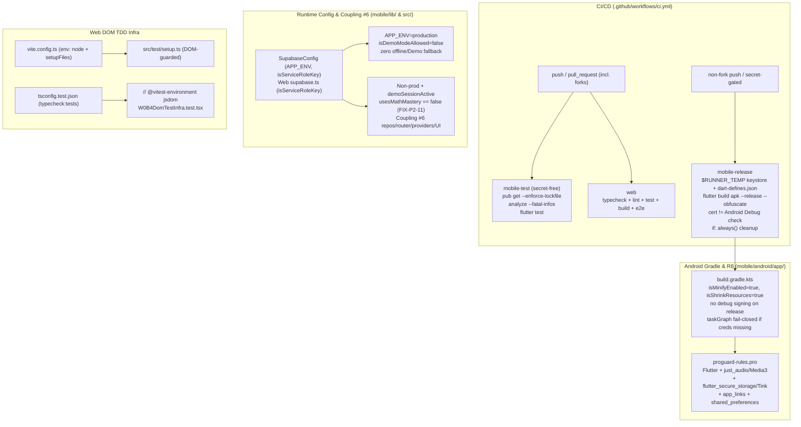

# Wave 0 · Batch `W0-B4` Pre-Implementation Scope Review & Implementation Plan

> **Status:** Pre-Implementation Plan Locked & TDD RED Phase Active. Follows `W0-B3_IMPLEMENTATION_PLAN.md` format without modifying `W0-B1..B3` or `W1`–`W6` production code.

**Goal:** Eliminate the offline, debug-signed Android CI release APK vulnerability and configure fail-closed Android release signing, R8/ProGuard shrinking, CI secret/PR isolation, and `APP_ENV=production` zero-Demo/zero-`service_role` runtime validation (`FIX-P0-26`); fix Stage 4 Mobile `usesMathMastery` ignoring `demoSessionActive` alongside Coupling #6 (`FIX-P2-11`); document all 16 bug-codifying test suites (`14` Stage 8 + `2` Stage 10 SQL) with exact coupled lines and batch ownership; and install minimal Web DOM TDD enabling infrastructure (`jsdom`, `@testing-library/react`, `@testing-library/jest-dom`, `src/test/setup.ts`, `tsconfig.test.json`, `typecheck:tests`) while keeping `vite.config.ts` default `environment: 'node'` intact.

**Architecture:** Execute `W0-B4` across four tightly scoped workstreams on `fix/wave-0-b4-release-ci-tests` branched cleanly from `W0-B3` (`a86d5e43642bb9ac279e13514a5720b99952ba40`):
1. **Android Release Signing, R8/ProGuard & Fail-Closed Gradle (`FIX-P0-26`):** Remove `signingConfigs.getByName("debug")` from `release` in `mobile/android/app/build.gradle.kts`, configure `signingConfigs.create("release")` from `mobile/android/key.properties` or `ANDROID_KEYSTORE_*` environment variables, enforce `gradle.taskGraph.whenReady` fail-closed `GradleException("BLOCKED — RELEASE SIGNING CREDENTIALS MISSING: ...")` whenever a release task runs without valid non-debug release signing credentials, enable `isMinifyEnabled = true` and `isShrinkResources = true`, and add `mobile/android/app/proguard-rules.pro` covering Flutter, `just_audio`, `audio_session`, `androidx.media3`, `flutter_secure_storage`/Tink, `app_links`, and `shared_preferences_android`.
2. **CI Workflow Hardening & Secret-Free PR Split (`FIX-P0-26`):** Harden `.github/workflows/ci.yml` with top-level `permissions: contents: read` and `concurrency:`, add `timeout-minutes` to `web` and mobile jobs, and split `mobile` into secret-free `mobile-test` (`flutter pub get --enforce-lockfile`, `flutter analyze --fatal-infos`, `flutter test` — runs on all PRs including forks) and gated `mobile-release` (never runs on fork PRs or missing secrets, decodes keystore + `key.properties` + `dart-defines.json` into `$RUNNER_TEMP` with `if: always()` cleanup, runs `flutter build apk --release --dart-define-from-file=... --obfuscate --split-debug-info=...`, and verifies certificate != `CN=Android Debug`).
3. **Production `APP_ENV` Fail-Closed, `service_role` Guard, `FIX-P2-11` & Coupling #6:** Add `APP_ENV`, `isProductionEnv` (+ `@visibleForTesting bool? isProductionEnvOverride`), `isDemoModeAllowed`, `isDemoModeActive`, and `isServiceRoleKey()` to `mobile/lib/core/config/supabase_config.dart` (plus `isServiceRoleKey()` export in `src/core/config/supabase.ts`), fix `usesMathMastery` in `mobile/lib/domain/personalization/learning_start.dart` (`FIX-P2-11`), wire `demoSessionActive` & `isDemoModeActive` across Coupling #6 (`main.dart`, `router.dart`, `providers.dart`, `welcome_screen.dart`, `login_screen.dart` keeping `FIX-P1-04` gated for `W5-B3`, `demo_control_bar.dart`, `in_memory_*_repository.dart`, `supabase_*_repository.dart`, `supabase_ai_tutor_service.dart`, `ai_tutor_screen.dart`), and align `mobile/test/features/auth_accessibility_and_ui_test.dart:1880,3515` where `setUp` left `demoSessionActive.value = true` during online `AITutorScreen` assertions.
4. **Minimal Web DOM Test Infrastructure (`ENGINEERING_TRANSFORMATION_MASTER_PLAN.md:125`):** Install only `jsdom`, `@testing-library/react`, and `@testing-library/jest-dom` in `devDependencies`, keep `environment: 'node'` in `vite.config.ts` with `setupFiles: ['./src/test/setup.ts']` guarded on DOM globals, add `tsconfig.test.json` (`"exclude": []`, scoped to `src/test/**` and `src/__tests__/W0B4*.{ts,tsx}`) + `"typecheck:tests": "tsc -p tsconfig.test.json --noEmit"`, and preserve all `57` existing Node/SSR test files untouched.

**Canonical Spec References (in `global_ai_hackathon_jury/docs/hackathon-audit/`):**
- `FINAL_FINDINGS_MATRIX.md:196,219-220` (`FIX-P2-11`, `FIX-P0-26`, `FIX-P1-43`)
- `PRIORITIZED_FIXES.md:72-88,118` (`FIX-P0-26`, `FIX-P1-43`, `FIX-P2-11`)
- `ENGINEERING_TRANSFORMATION_MASTER_PLAN.md:13,38,72-77,123-144,529` (`W0-B4` scope, Coupling #6, `jsdom` + `@testing-library/react` TDD enablement, 16-suite batch ownership)
- `BUILD_TEST_CI_AUDIT.md:15-18,63-66,74,98-112` (CI APK, `environment: 'node'`, 14 Stage 8 bug-codifying tests)
- `QA_COVERAGE_AUDIT.md:13-15,80,85-90` (Stage 8 & Stage 10 test audit, `FIX-P2-11`)
- `RELEASE_READINESS_AUDIT.md:40,49-52` (Release blocker verification)
- `FINAL_RISK_REGISTER.md:124` (`ROAD-09` / `FIX-P2-11`)

---

## 1. Reference Baselines, Pre-Change Test Baseline & R1 Worktree Isolation Checks

### 1.1 Reference Baselines & Immutable Context
| Artifact / Worktree | Branch | Verified Commit SHA | Role & Status |
|---|---|---|---|
| **Original Audit Baseline** (`C:\Users\user\.gemini\antigravity\worktrees\Bilimyol\global_ai_hackathon_jury`) | audit snapshot | `5c22343b2246dedcee7866cd11931c48346cf65c` | **READ-ONLY.** Composite score `49.28 / 100 (NO-GO)`; hosts canonical `docs/hackathon-audit/`. |
| **W0-B3 Completed Baseline** (`C:\Users\user\.gemini\antigravity\worktrees\Bilimyol\fix_wave_0_critical_containment`) | `fix/wave-0-critical-containment` | `a86d5e43642bb9ac279e13514a5720b99952ba40` | **DO NOT MODIFY.** `7 / 121` `FIXED_LOCAL` (`FIX-P0-27`, `FIX-P0-28`, `FIX-P2-22`, `FIX-P0-23`, `FIX-P0-25`, `FIX-P1-44`, `FIX-P1-48`). Clean `git status --short`. |
| **W0-B4 Target Worktree** (`C:\Users\user\.gemini\antigravity\worktrees\Bilimyol\fix_wave_0_b4_release_ci_tests`) | `fix/wave-0-b4-release-ci-tests` | `a86d5e43642bb9ac279e13514a5720b99952ba40` | **Active W0-B4 worktree** branched strictly from `a86d5e43642bb9ac279e13514a5720b99952ba40`. |

### 1.2 Pre-Change Verified Test Baseline (`fix_wave_0_b4_release_ci_tests` @ `a86d5e43`)
Verified cleanly on `fix/wave-0-b4-release-ci-tests` prior to any W0-B4 changes (`worker_baseline_tests` handoff):
- **Web (`npm ci`):**
  - `npm run typecheck` (`tsc -b --pretty false`) → exit `0` (`0` errors; excludes `src/__tests__/**` per `tsconfig.app.json:33`).
  - `npm run lint` (`oxlint`) → exit `0` (`0` errors, `9` pre-existing `react(only-export-components)` warnings across `224` files).
  - `npm test` (`vitest run`) → exit `0` (`57` files, `347` passed, `0` failed, `0` skipped).
  - `npm run build` (`tsc -b && vite build`) → exit `0` (`2380` modules transformed).
- **Flutter (`mobile/`):**
  - `flutter pub get --enforce-lockfile` → exit `0` (Note: on Windows, Flutter rewrites LF→CRLF on 7 tracked generated registrant files with 0 semantic diff; restore via `git checkout -- ...` if touched).
  - `flutter analyze --fatal-infos` → exit `0` (`No issues found!`).
  - `flutter test` → exit `0` (`514` passed, `2` environment-gated offline skips in `mobile/test/integration/local_supabase_test.dart`, `0` failed).
- **Android Gradle (`mobile/android/`):**
  - `mobile/android/gradlew.bat` is gitignored/absent (`mobile/android/.gitignore:4-5`); cached Gradle `9.1.0` (`gradle-wrapper.properties:5`) runs cleanly.
  - `gradle.bat :app:signingReport` → exit `0`; reproduced `FIX-P0-26`: `Variant: release` currently prints `Config: debug`, `Alias: AndroidDebugKey`.
  - `gradle.bat :app:testDebugUnitTest` → exit `0` (`NO-SOURCE`, `0` existing Android native unit tests).
- **CI Workflow (`.github/workflows/ci.yml`):**
  - PyYAML `safe_load` → exit `0` (`['web', 'supabase-journey', 'mobile']`). `actionlint` is not installed on host.

### 1.3 R1 Worktree Isolation Checks
- `git branch --show-current` in `fix_wave_0_b4_release_ci_tests` == `fix/wave-0-b4-release-ci-tests`.
- `git rev-parse HEAD` == `a86d5e43642bb9ac279e13514a5720b99952ba40`.
- `global_ai_hackathon_jury` (`5c22343b2246dedcee7866cd11931c48346cf65c`) and `fix_wave_0_critical_containment` (`a86d5e43642bb9ac279e13514a5720b99952ba40`) remain untouched.
- Zero `.agents/teamwork/` metadata inside any git worktree; zero destructive git commands (`reset --hard`, `clean -fd`, force checkout); zero `git push`, `git merge`, `git rebase`, Vercel deploy, or remote Supabase writes.

---

## 2. Locked Changed-File Scope & Explicit Do-Not-Touch Boundaries

### 2.1 Explicit Allowlist of Files W0-B4 Will Add or Edit
**Documentation & Remediation Tracking (`3` files):**
1. `docs/implementation/wave-0/W0-B4_IMPLEMENTATION_PLAN.md` *(new — this plan)*
2. `docs/implementation/wave-0/W0-B4_REPORT.md` *(new — post-implementation verification & review report)*
3. `docs/implementation/REMEDIATION_PROGRESS.md` *(update `W0-B4` `FIX-P0-26` and `FIX-P2-11` rows only when verified `FIXED_LOCAL`, preserving `121` total & `49.28 / 100` baseline)*

**CI & Android Release Hardening (`3` files):**
4. `.github/workflows/ci.yml` *(top-level `permissions`/`concurrency`, timeouts, split secret-free `mobile-test` vs gated `mobile-release`)*
5. `mobile/android/app/build.gradle.kts` *(release `signingConfigs`, `isMinifyEnabled = true`, `isShrinkResources = true`, `proguard-rules.pro`, `gradle.taskGraph.whenReady` fail-closed guard; preserve `applicationId = "uz.bilimyol.mobile"` & `namespace = "uz.bilimyol.bilimyol_mobile"`)*
6. `mobile/android/app/proguard-rules.pro` *(new — Flutter, `just_audio`, `audio_session`, `androidx.media3`, `flutter_secure_storage`, Tink, `app_links`, `shared_preferences_android`)*

**Web Minimal Test Infrastructure, `service_role` Guard & Acceptance Tests (`8` files):**
7. `package.json` *(minimal `devDependencies`: `jsdom`, `@testing-library/react`, `@testing-library/jest-dom`; add `"typecheck:tests": "tsc -p tsconfig.test.json --noEmit"`)*
8. `package-lock.json` *(minimal lockfile delta strictly for those 3 devDependencies + transitive deps)*
9. `vite.config.ts` *(preserve `environment: 'node'` and `W0-B2` `codeSplitting.groups`; add `setupFiles: ['./src/test/setup.ts']`)*
10. `tsconfig.test.json` *(new — extends `./tsconfig.app.json`, `"exclude": []`, includes `src/test/**` and `src/__tests__/W0B4*.{ts,tsx}`)*
11. `src/test/setup.ts` *(new — DOM-guarded `@testing-library/jest-dom/vitest` + `cleanup()`)*
12. `src/core/config/supabase.ts` *(additive `isServiceRoleKey()` export & `isSupabaseConfigured` guard; preserve `flowType: 'pkce'` & `FALLBACK_URL`/`FALLBACK_KEY`)*
13. `src/__tests__/W0B4ReleasePipelineAndSecurity.test.ts` *(new — Node env CI/Gradle/ProGuard/`isServiceRoleKey` contract tests)*
14. `src/__tests__/W0B4DomTestInfra.test.tsx` *(new — `// @vitest-environment jsdom` RTL + jest-dom DOM interaction acceptance test)*

**Mobile `APP_ENV` Fail-Closed, `FIX-P2-11` & Coupling #6 (`16` files):**
15. `mobile/lib/core/config/supabase_config.dart` *(additive `appEnv`, `isProductionEnv`, `isProductionEnvOverride`, `isDemoModeAllowed`, `isDemoModeActive`, `configurationError`, `isServiceRoleKey()`, fail-closed prod init, clear `demoSessionActive` on auth session; preserve `W0-B3` `SecureAuthStorageCoordinator`, PKCE, recovery lock, `verifyActiveSessionOrSignOut`)*
16. `mobile/lib/domain/personalization/learning_start.dart` *(`FIX-P2-11` — check `SupabaseConfig.isProductionEnv || !demoSessionActive.value` inside `usesMathMastery`)*
17. `mobile/lib/main.dart` *(guard demo session persistence/listener with `!SupabaseConfig.isProductionEnv`)*
18. `mobile/lib/app/router.dart` *(add defaulted `bool isDemoAllowed = true` to `resolveAppRedirect` so `W0-B3` call sites remain untouched; wire `effectiveDemoActive` and `isProductionEnv`)*
19. `mobile/lib/app/providers.dart` *(update `_resolveCurrentAuthSessionScope()`, `aiTutorServiceProvider`, and `_completeLesson` `isDemoModeActive` check; preserve `W0-B1` `deriveCanonicalReinforcementNodeId` & `W0-B3` `authSessionUserIdProvider`)*
20. `mobile/lib/features/auth/welcome_screen.dart` *(`hasActiveSession` checks `!SupabaseConfig.isProductionEnv && demoSessionActive.value`)*
21. `mobile/lib/features/auth/login_screen.dart` *(harden `L107`/`L386` with `SupabaseConfig.isProductionEnv`, keeping `FIX-P1-04` gated for `W5-B3`; clear `demoSessionActive` on real login; preserve `W0-B3` `postLoginHydrating`)*
22. `mobile/lib/core/widgets/demo_control_bar.dart` *(branch on `SupabaseConfig.isDemoModeActive`)*
23. `mobile/lib/data/repositories/in_memory_lesson_repository.dart` *(branch on `!SupabaseConfig.isDemoModeActive`)*
24. `mobile/lib/data/repositories/in_memory_course_repository.dart` *(branch on `!SupabaseConfig.isDemoModeActive`)*
25. `mobile/lib/data/repositories/supabase_course_repository.dart` *(branch on `SupabaseConfig.isDemoModeActive`)*
26. `mobile/lib/data/repositories/supabase_learner_repository.dart` *(branch on `SupabaseConfig.isDemoModeActive`; preserve `W0-B3` `bilimyol.srs.<uid>`)*
27. `mobile/lib/data/repositories/supabase_lesson_repository.dart` *(branch on `SupabaseConfig.isDemoModeActive`)*
28. `mobile/lib/data/services/supabase_ai_tutor_service.dart` *(throw `AITutorUnavailableException` whenever `!SupabaseConfig.isDemoModeActive`)*
29. `mobile/lib/features/ai_tutor/ai_tutor_screen.dart` *(show demo status badge on `SupabaseConfig.isDemoModeActive`)*
30. `mobile/test/features/auth_accessibility_and_ui_test.dart` *(explicit `demoSessionActive.value = false` + `addTearDown` at `L1880` and `L3515` where online `AITutorScreen` tests previously relied on `hasRemoteConfiguration = true` overriding `setUp`'s `demoSessionActive.value = true`)*
31. `mobile/test/features/w0_b4_release_config_and_demo_guard_test.dart` *(new — `FIX-P2-11`, Coupling #6, `APP_ENV=production` fail-closed & `isServiceRoleKey` tests)*

### 2.2 Explicit Do-Not-Touch Boundaries
- **Prior Wave 0 Approved Files (`R3`/`R5`):** Do NOT revert, modify, or weaken any `W0-B1`, `W0-B2`, or `W0-B3` tests (`W0B1ReinforcementResolution.test.tsx`, `W0B2BundleAnswerKeyIsolation.test.ts`, `W0B3AuthSessionAndRecoveryIsolation.test.tsx`, `AdminContentQueries.test.ts`, `EnglishTier5ComponentHarness.test.tsx`, `w0_b1_reinforcement_resolution_test.dart`, `cross_course_isolation_test.dart`, `w0_b3_account_isolation_and_secure_storage_test.dart`, `local_supabase_test.dart`, `w0_b1_security_and_reinforcement_regression.sql`, `tutor_and_learning_activity_regression.sql`, `w0_b3_admin_and_session_regression.sql`, `tests/e2e/supabase.mjs`) or `W0-B1..B3` security invariants (`uz.bilimyol.mobile`, `allowBackup="false"`, `SecureAuthStorageCoordinator`, `verifyActiveSessionOrSignOut()`, `postLoginHydrating`, `codeSplitting.groups`, `flowType: 'pkce'`).
- **`W1`–`W6` Production Code & Tests (`R3`/`R5`):** Do NOT modify any of the `15` remaining bug-codifying test suites, `FIX-P1-04` (`W5-B3` showing Demo button on remote `LoginScreen`), `FIX-P1-43` (`W6-B1` refactoring the 4+ legacy Web test suites or fixing the 51 pre-existing test TS errors), or `W1`–`W6` features/content.
- **`assetlinks.json` (Android App Links):** Out of scope for `W0-B4` (0 matches in `docs/hackathon-audit/`; absent from `public/.well-known/`; `AndroidManifest.xml:30-35` has only `uz.bilimyol.mobile://auth/reset-password`). Documented as `BLOCKED` until a real production release signing certificate SHA-256 fingerprint is provisioned in CI/signing infrastructure.
- **Web E2E Offline Compatibility (`tests/e2e/run.mjs`):** Do NOT disable Web Demo mode when `import.meta.env.PROD === true` and `VITE_SUPABASE_*` are empty, because `npm run test:e2e` explicitly builds with `mode: 'e2e-offline'` (`import.meta.env.PROD === true`) to test Demo journeys.

---

## 3. Canonical Verification of `FIX-P0-26`, `FIX-P2-11` & Web DOM Infrastructure

| Item | Canonical Audit Source | Exact Title / Scope | Target Files | Distinction / Boundary |
|---|---|---|---|---|
| **`FIX-P0-26`** *(ENG-04)* | `PRIORITIZED_FIXES.md:72-86`, `FINAL_FINDINGS_MATRIX.md:219`, `BUILD_TEST_CI_AUDIT.md:63-66,98-112` | `Stage 8 & 10 — CI Android Release APK Compiled Offline (hasRemoteConfiguration = false), Signed With Public debug Keystore, & 16 Test Suites Codifying P0/P1 Bugs (14 Stage 8 + 2 Stage 10 SQL)` | `.github/workflows/ci.yml`, `mobile/android/app/build.gradle.kts`, `mobile/android/app/proguard-rules.pro`, `mobile/lib/core/config/supabase_config.dart`, `src/core/config/supabase.ts` | Release signing fails closed if missing (`BLOCKED — RELEASE SIGNING CREDENTIALS MISSING`); R8 + `just_audio`/Media3 keep rules enabled; `APP_ENV=production` disables offline/Demo fallback & rejects `service_role`. |
| **`FIX-P2-11`** *(ROAD-09)* | `PRIORITIZED_FIXES.md:118`, `FINAL_FINDINGS_MATRIX.md:196`, `FINAL_RISK_REGISTER.md:124`, `ENGINEERING_TRANSFORMATION_MASTER_PLAN.md:77,125,128` | `P2 — Stage 4 Mobile usesMathMastery Ignores demoSessionActive Flag` | `mobile/lib/domain/personalization/learning_start.dart:8-9` + Coupling #6 sites | **NOT `jsdom`/RTL.** Fixes `!demoSessionActive.value` check in Mobile `usesMathMastery` + Coupling #6 across router/providers/repos/screens. |
| **Web DOM TDD Infra** | `ENGINEERING_TRANSFORMATION_MASTER_PLAN.md:125,144` | W0-B4 TDD enabling infrastructure: install `jsdom`, `@testing-library/react`, `@testing-library/jest-dom` (`// @vitest-environment jsdom` per-file opt-in) + `tsconfig.test.json` | `package.json`, `package-lock.json`, `vite.config.ts`, `src/test/setup.ts`, `tsconfig.test.json` | Distinct from `FIX-P1-43` (`W6-B1`: converting 70 legacy static/SSR tests & fixing 51 pre-existing test TS errors across 15 files). Preserves `environment: 'node'` default. |

---

## 4. Cross-Batch Dependencies

1. **Upstream `W0-B1..B3` Invariants Preserved:**
   - `W0-B1`: Keep `deriveCanonicalReinforcementNodeId` in `mobile/lib/app/providers.dart:1855-1906` and `tutor_and_learning_activity_regression.sql:46-59` untouched.
   - `W0-B2`: Keep `build.rolldownOptions.output.codeSplitting.groups` in `vite.config.ts:17-36` and `W0B2BundleAnswerKeyIsolation.test.ts` untouched.
   - `W0-B3`: Keep `applicationId = "uz.bilimyol.mobile"` (`build.gradle.kts:19`), `android:allowBackup="false"` (`AndroidManifest.xml:7`), `SecureAuthStorageCoordinator` (`supabase_config.dart`), `authSessionUserIdProvider` & `postLoginHydrating` (`providers.dart`, `router.dart`), `flowType: 'pkce'` (`supabase.ts`), and `resolveAppRedirect`'s existing parameter contract (any new `isDemoAllowed` parameter MUST default to `true` so all 6 call sites in `w0_b3_account_isolation_and_secure_storage_test.dart` compile untouched).
2. **Downstream `W1`–`W5` Test & Feature Ownership:**
   - `W1`–`W5` depend on `W0-B4`'s `jsdom` + `@testing-library/react` TDD harness (`ENGINEERING_TRANSFORMATION_MASTER_PLAN.md:144`).
   - `FIX-P1-04` (showing the 1-click Demo CTA on `LoginScreen` when `hasRemoteConfiguration == true`) remains owned by `W5-B3` (`REMEDIATION_PROGRESS.md:77`). `W0-B4` completes the underlying Coupling #6 runtime/data wiring and guards `login_screen.dart:107,386` with `!SupabaseConfig.isProductionEnv` without prematurely exposing the UI button.
   - `p1_persistence_contracts_test.dart:173-188` MUST continue to pass unchanged: when `hasRemoteConfiguration == true` and `demoSessionActive.value == false`, `SupabaseCourseRepository` & `SupabaseLessonRepository` throw `StateError` and `SupabaseLearnerRepository` reports `supportsNodeCompletion == false`, `supportsServerPlacementPersistence == true`.
3. **Downstream `W6-B1` (`FIX-P1-43`) Test Typecheck Debt:**
   - Probing `tsc` across all `57` existing `src/__tests__/*` files surfaces `51` pre-existing diagnostics across `15` files (`13` in `W0B1ReinforcementResolution.test.tsx` & `W0B2BundleAnswerKeyIsolation.test.ts` which are protected by `R3`, plus `38` across `13` `W6-B1` files). `tsconfig.test.json` cleanly typechecks `src/test/**` and `src/__tests__/W0B4*.{ts,tsx}` without hiding or altering the `51` pre-existing diagnostics (logged in `W0-B4_REPORT.md` for `W6-B1`).

---

## 5. Full 16-Suite Audit Table (`14` Stage 8 + `2` Stage 10 SQL)

Every suite below was inspected in full (`worker_survey_2`). **`0 / 16` are modified in `W0-B4`**: `1` was already remediated in `W0-B1`, and `15` codify defects belonging to `W1`–`W5` whose production code `W0-B4` must not touch.

| # | File Path | Exact Coupled Lines & Defect Codified | Root Cause | Contract Status | Batch Ownership | `W0-B4` Action |
|---:|---|---|---|---|---|---|
| 1 | `src/__tests__/EnglishPlacementAdaptiveAndYolchi.test.tsx` (`1103` L) | `L128-153,180-193`: asks `8` items (`difficulty !== 'hard'`, `0` `B1`) & expects `placementCefr === 'B1'` (`FIX-P0-11`). `L412-417,438,953-1000`: locks Light `<Badge>`/`InteractiveLessonView` to pastel text & `.not.toContain` accessible dark hexes (`FIX-P0-19`). `L310,411`: expects `'Keyingi bosqich (DEFERRED)'`/`'DEFERRED'` (`FIX-P2-17`). | Snapshots lock broken B1 fallback, Dark-first pastel badges on Light UI, and `(DEFERRED)` copy. | Broken Contract (`FIX-P0-11`, `FIX-P0-19`, `FIX-P2-17`) | `W1-B3`, `W5-B1`, `W5-B2` | **DO NOT MODIFY** |
| 2 | `src/__tests__/ServerScoringAndAntiCheat.test.ts` (`155` L) | `L52,147-153`: submits 1 placement question (`q_math_alg_01`) with `lessonId = 'lesson_stat'` & asserts `algScore?.score === 100`, `masteryLevel === 'mastered'` (`FIX-P1-09`). | `InMemoryLearnerRepository` computes `1/1 = 100%` and accepts placement IDs in lessons. | Broken Contract (`FIX-P1-09`) | `W1-B3` | **DO NOT MODIFY** |
| 3 | `src/__tests__/FlashcardAndFreeText.test.tsx` (`190` L) | `L138`: after 1 starter free-text answer (`lesson_eng_starter`), asserts `scoresByCourse['course_eng_01']?.['skill_eng_vocab']?.score === 100` (`FIX-P1-09`). | Uncalibrated `1/1 = 100%` starter mastery calculation. | Broken Contract (`FIX-P1-09`) | `W1-B3` | **DO NOT MODIFY** |
| 4 | `src/__tests__/LessonViewLocalization.test.tsx` (`77` L) | `L39,75`: in `language === 'ru'`, asserts `listeningHtml` contains Uzbek `'Audio Xabarni Tinglash'` (`FIX-P1-06`). | Hardcoded Uzbek step heading in `lesson_eng_listening_01`. | Broken Contract (`FIX-P1-06`) | `W2-B4` | **DO NOT MODIFY** |
| 5 | `mobile/test/domain/gemini_ai_tutor_test.dart` (`175` L) | `L50-67` (`L65`): asserts offline `DemoAITutorService().generateLesson(...)` returns `response.model == 'gemini-3.6-flash'` (`FIX-P1-25`). | Offline fallback hardcodes Gemini model string instead of `'deterministic-fallback'`. | Broken Contract (`FIX-P1-25`) | `W3-B1` | **DO NOT MODIFY** |
| 6 | `mobile/test/domain/skill_scoring_engine_test.dart` (`267` L) | `L200-210`: submits `8/8` (`a1Qs + a2Qs`, `0` `B1` items) to `computeEnglishPlacementCefr` & asserts `'B1'` (`FIX-P0-11`). | `computeEnglishPlacementCefr` defaults `b1Acc` to `higherAcc` when `b1Total == 0`. | Broken Contract (`FIX-P0-11`) | `W1-B3` | **DO NOT MODIFY** |
| 7 | `mobile/test/domain/route_engine_test.dart` (`307` L) | `L217-264` (`L260`): passes `skill_math_algebra: 82`, `completedNodeIds: []` & asserts `algNode.status == NodeStatus.completed` (`FIX-P1-08`). | Mobile `RouteEngine` marks unstudied `>=80%` diagnostic nodes `completed`. | Broken Contract (`FIX-P1-08`) | `W1-B4` | **DO NOT MODIFY** |
| 8 | `mobile/test/e2e/e2e_harness.dart` (`1209` L) | `L537`: `print(3 * "ab")` expects `'"ababab"'` (`FIX-P1-22`). `L552`: `'Chumchu uchadi'` (`FIX-P3-03`). `L561`: `q_logic_puz_04` expects `'Vali – Ali – Olim'` (`FIX-P0-09`). `L400-655`: coupled option texts (`FIX-P0-10`). | Oracle map locks buggy curriculum stems/answers prior to `W2-B1`/`W2-B3`. | Broken Contract (`FIX-P0-09`, `FIX-P0-10`, `FIX-P1-22`) | `W2-B1`, `W2-B3` | **DO NOT MODIFY** |
| 9 | `mobile/test/e2e/tier4_journeys_test.dart` (`591` L) | `L82-85,304-307`: taps `'Dashboardga O‘tish'` after mid-lesson `ReinforcementSheet` completion (`FIX-P1-33`). | `ReinforcementSheet` forces exit to `/dashboard` instead of returning to lesson/roadmap. | Broken Contract (`FIX-P1-33`, `W2-B1`) | `W4-B3`, `W2-B1` | **DO NOT MODIFY** |
| 10 | `tests/e2e/journey.mjs` (`290` L) | `L258`: in `russianViews` (`language === 'ru'`), expects Uzbek `'Kvadratni ochish'` for `lesson_math_algebra_01` (`FIX-P1-06`). | Math lessons lack Russian titles in `SEED_LESSONS`. | Broken Contract (`FIX-P1-06`) | `W2-B4` | **DO NOT MODIFY** |
| 11 | `tests/e2e/english-suite/tier1-features.mjs` (`1532` L) | `L249-253,337-340,812-816,1100-1104`: asserts `'Keyingi bosqich (DEFERRED)'`/`DEFERRED` (`FIX-P2-17`). `L325-336,989-990`: expects `8/8` (`0` `B1`) to yield `B1` (`FIX-P0-11`). | E2E assertions mirror `(DEFERRED)` UI copy and untested `B1` placement. | Broken Contract (`FIX-P0-11`, `FIX-P2-17`) | `W1-B3`, `W5-B2` | **DO NOT MODIFY** |
| 12 | `supabase/tests/beginner_learning_start_regression.sql` (`59` L) | `L23`: manually `UPDATE`s `selected_course_id = 'course_eng_01'` before `save_course_learning_plan` (hiding `FIX-P1-39`). `L29-33,49-52`: asserts 3-step MCQ `lesson_eng_starter` (`FIX-P0-01`). | SQL `lessons` has legacy 3-step MCQ starter and `UPDATE`-only RPC. | Broken Contract (`FIX-P0-01`, `FIX-P1-39`) | `W1-B2`, `W4-B2` | **DO NOT MODIFY** |
| 13 | `supabase/tests/placement_sessions_regression.sql` (`122` L) | `L30-39,105-108`: requires `q_live_*` IDs (`FIX-P0-02`). `L116-118`: asserts placement populates 4 rows in `public.learner_skill_scores` (`FIX-P0-02`, `FIX-P1-19`). | Separate `q_live_eng_*` SQL bank & unisolated `learner_skill_scores` writes. | Broken Contract (`FIX-P0-02`, `FIX-P1-19`) | `W1-B3` | **DO NOT MODIFY** |
| 14 | `supabase/tests/math_mastery_pilot_regression.sql` (`176` L) | `L61`: asserts `4/4` Math placement leaves `0` unlocked (`FIX-P1-08`). `L171`: asserts 1 Day-8 review miss re-locks `nodes->1` (`FIX-P1-17`). | `math_progression` ignores placement & lacks `previously_completed`. | Broken Contract (`FIX-P1-08`, `FIX-P1-17`) | `W1-B4` | **DO NOT MODIFY** |
| 15 *(Stage 10 #1)* | `supabase/tests/p1_persistence_regression.sql` (`248` L) | `L141-142`: asserts `save_placement_attempt('course_eng_01', ...)` writes `score = 50` into `public.learner_skill_scores` (`FIX-P0-02`, `FIX-P1-19`). | `save_placement_attempt` writes English placement scores into lesson mastery table. | Broken Contract at `L141-142` (`FIX-P0-02`, `FIX-P1-19`) | `W1-B3` | **DO NOT MODIFY** |
| 16 *(Stage 10 #2)* | `supabase/tests/tutor_and_learning_activity_regression.sql` (`89` L) | **Already fixed in `W0-B1` (`10a652a`, `6040f39`)!** `L46-58` asserts 1st Math miss yields `correctOption IS NULL` & 2nd reveals `'7'` (`FIX-P0-28`). | Fixed in `W0-B1` migration `20261124000100`. | Matches `W0-B1` (`FIXED_LOCAL`) | `W0-B1` (Completed) | **DO NOT MODIFY** |

---

## 6. Concrete Design & TDD RED → GREEN Plan

### 6.1 TDD RED Phase (Executed BEFORE Any Production/Config/Package Changes)
Write three dedicated W0-B4 test suites and capture verbatim RED failures:
1. **`src/__tests__/W0B4ReleasePipelineAndSecurity.test.ts`** (Node env):
   - Asserts `.github/workflows/ci.yml` defines top-level `permissions: contents: read`, `concurrency:`, splits secret-free `mobile-test` (`flutter pub get --enforce-lockfile`, `flutter analyze --fatal-infos`, `flutter test`) from gated `mobile-release` (never runs release APK build or `upload-artifact` on fork PRs or missing secrets, decodes secrets into `$RUNNER_TEMP` with `if: always()` cleanup, passes `--dart-define-from-file` + `--obfuscate --split-debug-info`, checks cert != `Android Debug`).
   - Asserts `mobile/android/app/build.gradle.kts` never assigns `signingConfigs.getByName("debug")` to `release`, sets `isMinifyEnabled = true` and `isShrinkResources = true`, references `proguard-rules.pro`, and fails closed with `BLOCKED — RELEASE SIGNING CREDENTIALS MISSING` on release tasks when credentials are absent.
   - Asserts `mobile/android/app/proguard-rules.pro` exists with keep rules for `io.flutter.**`, `com.ryanheise.just_audio.**`, `com.ryanheise.audio_session.**`, `androidx.media3.**`, `com.it_nomads.fluttersecurestorage.**`, `com.google.crypto.tink.**`, `com.llfbandit.app_links.**`, `io.flutter.plugins.sharedpreferences.**`.
   - Asserts `isServiceRoleKey` exported from `src/core/config/supabase.ts` rejects `sb_secret_...` and JWTs with `role: "service_role"` while allowing valid `anon` JWTs.
2. **`src/__tests__/W0B4DomTestInfra.test.tsx`** (`// @vitest-environment jsdom`):
   - Imports `render`, `screen`, `fireEvent` from `@testing-library/react` and `@testing-library/jest-dom/vitest` matchers (`toBeInTheDocument`, `toHaveAttribute`).
   - Exercises real React DOM rendering and interaction on `PasswordInput` (`src/presentation/components/PasswordInput.tsx`) and `Button` (`src/presentation/components/Button.tsx`), proving `jsdom` + RTL + `jest-dom` + `useTranslation` work end-to-end. Fails RED before `jsdom`/`@testing-library/react`/`@testing-library/jest-dom` are installed.
3. **`mobile/test/features/w0_b4_release_config_and_demo_guard_test.dart`**:
   - **`FIX-P2-11`**: With `hasRemoteConfiguration = true`, `isProductionEnvOverride = false`, and `demoSessionActive.value = true` → `usesMathMastery('course_math_01') == false`; with `demoSessionActive.value = false` → `true`.
   - **`Coupling #6`**: Non-prod with `hasRemoteConfiguration = true` & `demoSessionActive.value = true` → `SupabaseConfig.isDemoModeActive == true`, `InMemoryLessonRepository().getLessonById('lesson_math_starter')` returns non-null, `SupabaseLearnerRepository().supportsNodeCompletion == true`, `SupabaseCourseRepository().getPlacementQuestions('course_math_01')` returns demo questions, and `resolveAppRedirect(..., isRemoteConfigured: true, isLoggedIn: false, isDemoActive: true, isDemoAllowed: true)` allows demo session.
   - **`FIX-P0-26` (`APP_ENV=production` fail-closed & `service_role` guard)**:
     - `SupabaseConfig.isServiceRoleKey(...)` returns `true` for `sb_secret_test` and JWT with `role: "service_role"`, `false` for `anon` JWT.
     - With `isProductionEnvOverride = true`: `isDemoModeAllowed == false`, `isDemoModeActive == false` even when `hasRemoteConfiguration = false` and `demoSessionActive.value = true`; `usesMathMastery('course_math_01') == true` when `hasRemoteConfiguration = true`; `SupabaseCourseRepository().getPlacementQuestions('course_math_01')` & `SupabaseLessonRepository().getLessonById('lesson_math_starter')` throw `StateError`; `SupabaseAITutorService().explainMistake(...)` throws `AITutorUnavailableException`; `resolveAppRedirect(..., isRemoteConfigured: true, isLoggedIn: false, isDemoActive: true, isDemoAllowed: false)` redirects away from protected routes (`/dashboard` → `/login` or `/welcome`).

### 6.2 Implementation Plan (GREEN Phase)
1. **Gradle & ProGuard (`mobile/android/app/`):**
   - Create `proguard-rules.pro` with Flutter, `just_audio`, `audio_session`, `androidx.media3`, `flutter_secure_storage`, Tink, `app_links`, and `shared_preferences_android` keep rules.
   - Update `build.gradle.kts` to load `key.properties` or `ANDROID_KEYSTORE_*` env vars, reject debug keystore/alias, configure `signingConfigs.create("release")`, enable `isMinifyEnabled = true` + `isShrinkResources = true` + `proguardFiles(...)`, never assign `debug` signing to `release`, and enforce `gradle.taskGraph.whenReady` throwing `GradleException("BLOCKED — RELEASE SIGNING CREDENTIALS MISSING: ...")` if release tasks run without credentials.
2. **CI Hardening (`.github/workflows/ci.yml`):**
   - Add top-level `permissions: contents: read` and `concurrency:`.
   - Add `timeout-minutes` on `web` and mobile jobs.
   - Split `mobile` into `mobile-test` (secret-free: `flutter pub get --enforce-lockfile`, `flutter analyze --fatal-infos`, `flutter test`) and `mobile-release` (gated on non-fork `push`/manual/configured secrets; decodes `ANDROID_KEYSTORE_BASE64`, writes `key.properties` & `dart-defines.json` to `$RUNNER_TEMP`; runs `flutter build apk --release --dart-define-from-file="$RUNNER_TEMP/dart-defines.json" --obfuscate --split-debug-info=...`; verifies APK cert via `apksigner` / `keytool` != `Android Debug` and refuses `service_role`; deletes `$RUNNER_TEMP` secret artifacts in `if: always()`).
3. **Mobile Runtime Config & Coupling #6 (`mobile/lib/` + `auth_accessibility_and_ui_test.dart`):**
   - Implement `appEnv`, `isProductionEnv`, `isProductionEnvOverride`, `isDemoModeAllowed`, `isDemoModeActive`, `configurationError`, and `isServiceRoleKey()` in `supabase_config.dart`.
   - Update `usesMathMastery` in `learning_start.dart` (`FIX-P2-11`) and all Coupling #6 sites (`main.dart`, `router.dart`, `providers.dart`, `welcome_screen.dart`, `login_screen.dart`, `demo_control_bar.dart`, `in_memory_*_repository.dart`, `supabase_*_repository.dart`, `supabase_ai_tutor_service.dart`, `ai_tutor_screen.dart`), plus set `demoSessionActive.value = false` in `auth_accessibility_and_ui_test.dart:1880,3515`.
4. **Web Test Infra & `isServiceRoleKey` (`src/core/config/supabase.ts`, `package.json`, `vite.config.ts`, `tsconfig.test.json`, `src/test/setup.ts`):**
   - Install `jsdom`, `@testing-library/react`, `@testing-library/jest-dom` (`npm install --save-dev ...`), inspect `package-lock.json` diff.
   - Export `isServiceRoleKey()` in `src/core/config/supabase.ts` and include `!isServiceRoleKey(rawSupabaseKey)` in `isSupabaseConfigured`.
   - Add `src/test/setup.ts`, wire `setupFiles: ['./src/test/setup.ts']` in `vite.config.ts` (keeping `environment: 'node'`), add `tsconfig.test.json` + `npm run typecheck:tests`.

### 6.3 Post-Implementation Verification Gates
- **Web:** `npm run typecheck`, `npm run typecheck:tests`, `npm run lint`, `npm test`, `npm run build`, `npm run test:e2e`.
- **Flutter:** `cd mobile && flutter analyze --fatal-infos && flutter test`.
- **Android Gradle:**
  - Without release secrets: `gradle.bat :app:assembleRelease` / `flutter build apk --release` fails closed with `BLOCKED — RELEASE SIGNING CREDENTIALS MISSING`.
  - Without release secrets: `gradle.bat :app:testDebugUnitTest` / `flutter build apk --debug` succeeds.
  - With temporary disposable test keystore (created in scratch and deleted after verification): `flutter build apk --release` succeeds with R8 `mapping.txt` generated and `apksigner verify --print-certs` != `CN=Android Debug`.
- **CI:** PyYAML `safe_load` + bash syntax checks (`bash -n` on embedded scripts if available).
